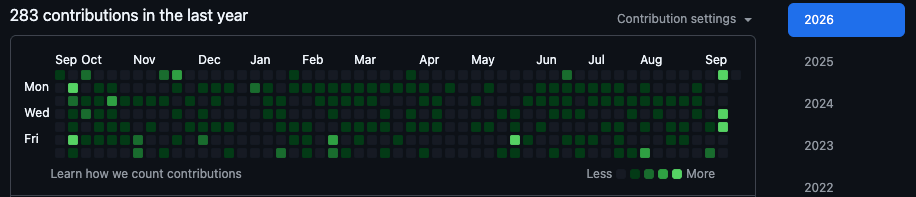

# 목차

- [개요](#개요)
  - [홈](#홈)
  - [인기](#인기)
  - [관찰](#관찰)
  - [내 피드](#내-피드)
- [분석](#분석)
  - [전체 성격](#전체-성격)
  - [홈 분석](#홈-분석)
    - [카운팅 카드 클릭 이동](#카운팅-카드-클릭-이동)
    - [알림 클릭 시 target 상세 이동](#알림-클릭-시-target-상세-이동)
  - [인기 분석](#인기-분석)
    - [랭킹 카드 description 제거](#랭킹-카드-description-제거)
    - [랭킹 아래 인기 target 최근 이벤트 목록](#랭킹-아래-인기-target-최근-이벤트-목록)
  - [관찰 상세 분석](#관찰-상세-분석)
    - [아이템 상세 그래프](#아이템-상세-그래프)
    - [스트리머 상세](#스트리머-상세)
    - [아티스트 상세](#아티스트-상세)
  - [내 피드 분석](#내-피드-분석)
    - [화면 용어 정리](#화면-용어-정리)
    - [관찰대상 등록폼](#관찰대상-등록폼)
  - [추천 구현 순서](#추천-구현-순서)
  - [구현 범위 추천](#구현-범위-추천)
- [추가사항1](#추가사항1)
  - [추가사항1 분석](#추가사항1-분석)
    - [스트리머 방송추이](#스트리머-방송추이)
    - [스트리머 채팅 기록](#스트리머-채팅-기록)
    - [내 피드 관찰대상 등록폼](#내-피드-관찰대상-등록폼)
    - [아이템 가격 변동 그래프](#아이템-가격-변동-그래프)
    - [인기탭 이벤트 분리](#인기탭-이벤트-분리)
    - [상단바 서비스 버튼](#상단바-서비스-버튼)
- [추가사항2](#추가사항2)
  - [추가사항2 분석](#추가사항2-분석)
    - [영향 범위](#영향-범위)
    - [스트리머 방송기록 popover](#스트리머-방송기록-popover)
    - [아이템 가격 변동 그래프 popover](#아이템-가격-변동-그래프-popover)
    - [가격 그래프 크기와 좌우 마진](#가격-그래프-크기와-좌우-마진)
    - [아티스트 앨범 3D carousel](#아티스트-앨범-3d-carousel)
    - [앨범 상세 모달](#앨범-상세-모달)
    - [상단바 서비스 버튼 popover](#상단바-서비스-버튼-popover)
    - [추가사항2 추천 구현 순서](#추가사항2-추천-구현-순서)
- [추가사항3](#추가사항3)
  - [추가사항3 분석](#추가사항3-분석)
    - [상세페이지 카드 분리](#상세페이지-카드-분리)
    - [가격 그래프 pinned tooltip 해제](#가격-그래프-pinned-tooltip-해제)
    - [방송추이 바둑알 hover 정확도](#방송추이-바둑알-hover-정확도)
    - [아티스트 앨범 modal 중앙 정렬](#아티스트-앨범-modal-중앙-정렬)
    - [추가사항3 구현 대상](#추가사항3-구현-대상)

---

# 개요

- 피드 화면 디테일 조정하고 화면구조 마무리

## 홈

- 위에 카운팅 카드 눌렀을때 관찰 페이지로 이동
- 알림 눌렀을때 해당 타겟에 해당하는 관찰 상세페이지로 이동

## 인기

- 랭킹카드의 아이템에 description은 없어도 될듯
- 랭킹카드 밑에는 이전처럼 인기 타겟들의 최근 이벤트 목록

## 관찰

- 아이템 상세페이지 
  - 가격변동 그래프에서 x축에 날짜, y축에 가격적고 점에 마우스오버하면 가격표시
  - 가격변동 그래프 1주간, 1개월간, 3개월, 6개월, 12개월간 표시가능하도록 (그래프 기간 변동 가능하도록)
  - 그래프가 칸을 다 안쓰고 너무 가운데에만 있음
- 스트리머 상세페이지
  - 방송일자를 github commit 내역 포도알처럼 표현
  - 포도알에 마우스 올리면 그날 방송한 시간이랑 방송제목, 방송 총 시간 나오게 (17시에 방송시작, 방제 '안녕하세요', '방송 총 5시간 30분' 이런거)
  - 채팅친걸 목록으로 주르륵 다 볼 수 있게 (어디 채널에서 채팅을 쳤는지도 카드에 간략 표시되야함)
  - 스트리머도 스트리머 채널 원본링크 추가
- 아티스트 상세페이지
  - 막대그래프 말고 carousel로 최근앨범 순으로 앨범 표시하자 
  - 앨범 누르면 앨범의 발매일과 트랙들 볼 수 있게 (트랙별로 재생시간 표시하고 트랙누르면 작곡가, 작사가, 가사 나오게)

## 내 피드

- 코드로는 target이지만 화면에서는 target이란 표현대신 대상이라고 하자 관찰 대상
- 관찰대상 등록폼 추가
- 하나의 등록폼에서 아이템/스트리머/아티스트 탭구분해서 입력하도록
- 등록폼 내용은 일단 표시되는 내용 가지고 일단 구색만 만들어놓자 나중에 api 만들면 어차피 조정해야하니까

---

# 분석

> 분석 시작

## 전체 성격

`plan5`는 새로운 도메인 확장이라기보다, 현재 feed 3차 구현 이후의 화면 디테일 보정과 화면구조 마무리 작업이다.

범위는 크게 네 부분으로 나뉜다.

- feed 홈의 이동 흐름 보정
- 인기 화면의 랭킹/이벤트 구성 보정
- 관찰 target 상세 화면의 type별 디테일 고도화
- 내 피드의 용어 정리와 관찰대상 등록폼 추가

작업 범위 안에 간단한 링크/문구 수정과 상태가 필요한 복잡한 UI가 섞여 있으므로, 구현 순서를 잘 나누는 것이 좋다.

## 홈 분석

### 카운팅 카드 클릭 이동

현재 feed 홈의 요약 카드는 클릭할 수 없는 `article` 형태다.

현재 상태:

- 등록 수
- 관찰 중
- 새 알림
- 관심 항목

요구사항:

- 위 카운팅 카드를 눌렀을 때 관찰 페이지로 이동한다.

추천 구현:

- 요약 카드를 `Link`로 변경한다.
- 우선 모든 요약 카드는 `/feed/observations`로 이동해도 된다.
- 나중에 필터가 필요해지면 `/feed/observations?summary=watching` 같은 query를 고려한다.

주의점:

- 카드가 링크가 되므로 hover/focus 스타일을 추가한다.
- 현재 홈은 server component라 `Link` 변경만으로 충분하다.

### 알림 클릭 시 target 상세 이동

현재 feed 홈의 최근 이벤트는 `/feed/activities/[activityId]`로 이동한다.

요구사항:

- 알림을 눌렀을 때 해당 target의 관찰 상세페이지로 이동한다.

추천 모델:

```ts
type FeedActivity = {
  id: string;
  title: string;
  source: string;
  timeText: string;
  targetId: string;
};
```

추천 구현:

- `FeedActivity`에 `targetId`를 추가한다.
- mock activity마다 연결할 target id를 지정한다.
- 홈의 최근 이벤트 링크를 `/feed/targets/${activity.targetId}`로 변경한다.

주의점:

- 기존 `/feed/activities/[activityId]`는 호환 화면으로 유지한다.
- 인기 화면 아래 이벤트 목록도 같은 `targetId`를 사용하면 재사용하기 좋다.

## 인기 분석

### 랭킹 카드 description 제거

현재 `/feed/popular` 랭킹 항목은 target 이름, type badge, `target.summary`, trend badge를 보여준다.

요구사항:

- 랭킹카드의 아이템에 description은 없어도 될듯

추천 구현:

- 랭킹 항목에서 `target.summary` 표시를 제거한다.
- 대신 target 상태나 지표가 필요하다면 `statusText` 또는 `metricText` 정도만 작게 표시할 수 있다.
- 가장 깔끔한 방식은 `이름 + type badge + trend badge` 중심으로 압축하는 것이다.

### 랭킹 아래 인기 target 최근 이벤트 목록

현재 `/feed/popular`는 랭킹 카드만 표시한다.

요구사항:

- 랭킹카드 밑에는 이전처럼 인기 타겟들의 최근 이벤트 목록을 표시한다.

추천 구현:

- `FeedActivity`를 재사용하거나 `FeedTargetEvent`를 추가한다.
- 간단한 구현에서는 `viewModel.activities`를 인기 화면 아래에도 보여준다.
- 더 자연스러운 구현은 target의 `recentAlerts`를 기반으로 최근 이벤트 목록을 만들어 보여주는 것이다.

추천 방향:

- `FeedActivity`에 `targetId`를 추가한다.
- `/feed/popular` 하단에 `인기 target 최근 이벤트` 섹션을 추가한다.
- 이벤트 클릭 시 `/feed/targets/[targetId]`로 이동한다.

## 관찰 상세 분석

### 아이템 상세 그래프

현재 아이템 상세는 SVG 라인그래프 mock으로 가격 추이를 표시한다.

요구사항:

- x축에 날짜 표시
- y축에 가격 표시
- 점에 마우스오버하면 가격 표시
- 1주간, 1개월간, 3개월, 6개월, 12개월 기간 선택
- 그래프가 칸을 다 쓰도록 조정

현재 부족한 점:

- x축/y축 라벨이 없다.
- hover tooltip이 없다.
- 기간 선택 상태가 없다.
- 그래프 좌표가 가운데에 몰려 보일 수 있다.

추천 구현:

- 아이템 그래프를 별도 client component로 분리한다.
- 기간 탭을 추가한다.
  - `1주`
  - `1개월`
  - `3개월`
  - `6개월`
  - `12개월`
- 기간별 mock 가격 포인트를 모델에 추가하거나, 같은 값을 기간별로 변환해서 표시한다.
- SVG에 x축 날짜 라벨과 y축 가격 라벨을 추가한다.
- 각 점에 hover/focus 가능한 버튼 또는 circle을 두고 tooltip을 표시한다.

주의점:

- 현재 `FeedTargetDetailView`는 server component다.
- hover tooltip과 기간 선택은 상태가 필요하므로, 그래프만 client component로 분리하는 것이 좋다.
- chart library는 아직 도입하지 않고 SVG mock으로 구현하는 편이 현재 방향과 맞다.

### 스트리머 상세

현재 스트리머 상세는 방송 상태, 방송 추이, 이벤트 추이, 최근 방송/이벤트 목록 정도만 표시한다.

요구사항:

- 방송일자를 GitHub commit 내역 잔디처럼 표현
- hover 시 방송 시작 시간, 방송 제목, 총 방송 시간 표시
- 채팅 목록 표시
- 어느 채널에서 채팅했는지도 카드에 간략 표시
- 스트리머 채널 원본 링크 추가

추천 모델:

```ts
type FeedStreamerDetail = {
  broadcastStatus: 'live' | 'offline';
  broadcastTrendText: string;
  eventTrendText: string;
  recentEvents: string[];
  channelName: string;
  channelUrl: string;
  broadcastDays: FeedBroadcastDay[];
  chatMessages: FeedChatMessage[];
};

type FeedBroadcastDay = {
  id: string;
  dateText: string;
  startedAt: string;
  title: string;
  durationText: string;
  intensity: 0 | 1 | 2 | 3 | 4;
};

type FeedChatMessage = {
  id: string;
  channelName: string;
  message: string;
  timeText: string;
};
```

추천 UI:

- `방송 기록` 섹션을 추가한다.
- 잔디 UI는 작은 정사각형 grid로 표현한다.
- 각 칸은 `title` 속성이나 custom tooltip으로 방송 정보를 표시한다.
- `채팅 기록` 섹션을 추가한다.
- 스트리머 상세 안에 `원본 채널` 링크를 추가한다.

주의점:

- hover tooltip을 고도화하려면 client component가 필요하다.
- 1차 보정에서는 `title` 속성 기반 tooltip으로 시작해도 충분하다.

### 아티스트 상세

현재 아티스트 상세는 최근 신곡, 예정 발매, 신곡 발매 추이 막대그래프, 최근 발매 목록을 표시한다.

요구사항:

- 막대그래프 대신 최근 앨범 순 carousel 표시
- 앨범 클릭 시 앨범 발매일과 트랙 목록 표시
- 트랙별 재생시간 표시
- 트랙 클릭 시 작곡가, 작사가, 가사 표시

추천 모델:

```ts
type FeedArtistDetail = {
  latestReleaseTitle: string;
  upcomingReleaseText: string;
  releaseTrendText: string;
  releasePoints: number[];
  recentReleases: string[];
  albums: FeedArtistAlbum[];
};

type FeedArtistAlbum = {
  id: string;
  title: string;
  releaseDate: string;
  coverTone: string;
  tracks: FeedArtistTrack[];
};

type FeedArtistTrack = {
  id: string;
  title: string;
  duration: string;
  composer: string;
  lyricist: string;
  lyricsPreview: string;
};
```

추천 UI:

- `최근 앨범` carousel을 추가한다.
- 앨범 카드를 클릭하면 선택된 앨범 상세를 아래에 표시한다.
- 트랙 목록을 표시한다.
- 트랙 클릭 시 작곡가, 작사가, 가사 preview를 표시한다.

주의점:

- carousel과 선택 상태가 필요하므로 아티스트 상세 섹션은 client component로 분리하는 것이 좋다.
- 실제 앨범 이미지가 없으므로 mock cover block이나 tone swatch를 사용한다.

## 내 피드 분석

### 화면 용어 정리

현재 화면 곳곳에 `target`이라는 영어 표현이 노출된다.

요구사항:

- 코드에서는 target을 유지해도 되지만 화면에서는 `target` 대신 `대상`, `관찰 대상`이라고 표현한다.

수정 대상:

- `인기 target 랭킹`
- `실시간 target 랭킹`
- `관찰 target 추가`
- `관찰 target 요약`
- `feed / target` 라벨은 유지할지 검토 필요
- README의 화면 설명도 사용자 화면 설명에서는 `target` 대신 `대상`으로 바꾸는 것이 좋다.

추천 구현:

- 코드 타입명은 유지한다.
- 화면 텍스트만 `관찰 대상`으로 변경한다.
- depth 라벨은 개발자 감성 표기이므로 `feed / target`을 유지해도 되지만, 사용자 문장에서는 `target`을 제거한다.

### 관찰대상 등록폼

현재 내 피드 화면의 추가 버튼은 동작하지 않는다.

요구사항:

- 관찰대상 등록폼 추가
- 하나의 등록폼에서 아이템/스트리머/아티스트 탭 구분
- API 전까지 현재 표시되는 내용을 기준으로 구색만 만든다.

추천 구현:

- `FeedTargetCreateForm` client component를 추가한다.
- `/feed/me`의 추가 버튼을 누르면 등록폼을 펼치거나 모달로 보여준다.
- 현재 화면 구조에서는 모달보다 같은 화면 아래로 펼치는 패널이 구현이 간단하다.
- 탭은 `아이템`, `스트리머`, `아티스트`로 구성한다.

추천 입력 필드:

공통:

- 대상 이름
- 설명
- 원본 링크
- 알림 주기

아이템:

- 현재 가격
- 목표 가격

스트리머:

- 채널명
- 채널 URL
- 방송 알림 여부
- 채팅/이벤트 알림 여부

아티스트:

- 아티스트명
- 최근 발매곡
- 신곡/앨범 알림 여부
- 피처링/참여곡 알림 여부

주의점:

- 실제 등록 동작은 mock 처리한다.
- 저장 버튼 클릭 시 `등록 준비 완료` 같은 피드백만 표시한다.
- API 연결 전까지는 리스트에 실제 추가하지 않아도 된다.

## 추천 구현 순서

1. 화면 문구에서 `target`을 `대상`, `관찰 대상`으로 정리한다.
2. 홈 요약 카드를 `/feed/observations` 링크로 변경한다.
3. `FeedActivity`에 `targetId`를 추가하고 홈 알림 링크를 target 상세로 변경한다.
4. 인기 랭킹에서 description을 제거한다.
5. 인기 랭킹 아래 최근 이벤트 목록을 추가한다.
6. 내 피드에 관찰대상 등록폼을 추가한다.
7. 아이템 상세 그래프를 기간 선택, 축, hover tooltip이 있는 client component로 고도화한다.
8. 스트리머 상세에 방송 잔디, 채팅 목록, 원본 채널 링크를 추가한다.
9. 아티스트 상세에 앨범 carousel과 트랙 상세를 추가한다.

## 구현 범위 추천

안정적으로 끊는다면 다음 두 단계가 좋다.

1. 화면 흐름 마무리
   - 용어 정리
   - 홈 링크 수정
   - 알림 target 상세 이동
   - 인기 이벤트 목록
   - 관찰대상 등록폼
2. 상세 화면 고도화
   - 아이템 그래프 고도화
   - 스트리머 방송 잔디/채팅
   - 아티스트 앨범 carousel/트랙 상세

다만 `plan5`의 목적이 화면구조 마무리라면 한 번에 구현해도 된다. 이 경우 `FeedTargetDetailView`가 커질 수 있으므로 type별 상세 섹션을 별도 컴포넌트로 분리하는 것을 고려한다.

---

# 추가사항1

- 스트리머 방송추이 바둑알은 이런식으로
  
- 스트리머 채팅 기록에 어느채널에서 쳤는디는 '{chanel} 에서'라고 하면 될듯
- 내 피드 관찰대상 등록폼은 모달로
- 아이템 상세페이지 가격변동 그래프는 크기가 너무 작고, 좌우 카드 마진이 너무 많고, 선이 너무 굵음. 그리고 점에 마우스 올렸을때 마우스오버 팝업으로 나오게 해줘. 위에 가격표시 칸 지우고
- 인기탭에서 이벤트는 랭킹 카드와 별개로 (블로그의 인기탭 참고)
- 그 외 상탄바 알림버튼 오른쪽에 서비스 버튼도 추가 (플랫폼 툴바의 서비스 아이콘 쓰면 될듯)

## 추가사항1 분석

### 스트리머 방송추이

- 현재 방송 기록은 7열 정사각형 grid로 표시되어 있다.
- 추가 이미지의 의도는 GitHub contribution graph와 유사한 바둑알형 히트맵이다.
- 구현 방향은 월 라벨, 요일 라벨, 작은 바둑알, `Less` / `More` 범례를 가진 방송 기록 그래프다.
- 기존 `FeedBroadcastDay.intensity` 값은 그대로 사용하고, 표시 컴포넌트만 contribution graph 형태로 보정한다.

### 스트리머 채팅 기록

- 현재 채팅 기록은 채널명을 카드 제목처럼 분리해서 표시한다.
- 요청 문구는 채팅이 발생한 채널을 `{channel} 에서` 형태로 보여주는 것이다.
- 문서에는 `{chanel}`로 적혀 있지만 구현에서는 기존 필드명인 `channelName`을 기준으로 처리한다.

### 내 피드 관찰대상 등록폼

- 현재 `/feed/me`의 관찰대상 등록폼은 추가 버튼 클릭 시 본문에 펼쳐지는 구조다.
- 요청 방향은 등록폼을 모달로 띄우는 것이다.
- plus 버튼 클릭 시 등록 모달을 열고, 닫기 버튼 또는 배경 클릭으로 닫을 수 있게 구성한다.
- 기존 아이템, 스트리머, 아티스트 탭과 mock 입력 필드는 유지한다.

### 아이템 가격 변동 그래프

- 현재 그래프는 높이가 작고, 그래프 카드의 좌우 여백이 넓으며, 선 두께가 두껍다.
- 상단에 선택 가격 표시 칸이 별도로 있어 그래프 hover 피드백과 역할이 겹친다.
- 구현 방향은 그래프 높이를 키우고, 좌우 여백을 줄이고, 선 두께를 줄이는 것이다.
- 상단 가격표시 칸은 제거한다.
- 그래프 점에 mouse hover 또는 keyboard focus가 들어오면 날짜와 가격을 tooltip으로 표시한다.

### 인기탭 이벤트 분리

- 현재 `/feed/popular`의 이벤트 목록은 랭킹 카드 내부에 들어가 있다.
- 블로그 인기탭은 랭킹 섹션과 게시글 목록 섹션이 형제 섹션으로 분리되어 있다.
- feed 인기탭도 같은 방식으로 랭킹 섹션과 최근 이벤트 섹션을 분리하는 것이 맞다.

### 상단바 서비스 버튼

- 현재 공통 상단바 액션은 검색, 알림, 로그인 버튼으로 구성되어 있다.
- 요청 방향은 알림 버튼 오른쪽에 서비스 버튼을 추가하는 것이다.
- 서비스 버튼은 `/services`로 이동시키고, 기존 플랫폼 툴바에서 쓰는 `grid` 아이콘을 재사용한다.

---

# 추가사항2

- 스트리머 상세페이지 방송기록에서 바둑알에 마우스오버하면 조그마한 팝오버창으로 방송제목, 방송일자, 총방송시간 나오게 (하루에 두번 방송할수있으니까 그것도 고려)
- 아이템 상세페이지 가격변동그래프에서 y축 가격이 이상하게 나오고, 점에 마우스오버 때면 다시 팝오버창이 최신 점의 팝오버창으로 이동해서 뜨는데 그냥 팝오버창은 점에 마우스오버했을때만 나오고 마우스 때면 안나오게 (클릭 토글 기능도 넣어서 클릭하면 해당 점에 고정되고, 클릭한번더하면 해제되고)
- 여전히 가격변동그래프 크기가 작고 좌우 마진이 너무 넓음
- 아티스트 상세페이지의 앨범 carousel은 3d 형태였으면 좋겠음. 이미지가 앨범상자처럼 생겼고 그걸 좌우로 넘기면 앨범이 시계/반시계방향으로 돌아가는거임
- 앨범을 누르면 앨범 상세정보가 모달창이 뜨고, 모달에서 앨범 상세정보의 트랙누르면 누르면 모달내에서 다음페이지로 이동되서 곡 상세정보 나오고, 다시 앨범정보로 돌아가려면 모달 왼쪽위에 `<-` 뒤로가기 화살표 눌러서 돌아가고
- 상단바 서비스버튼 누르면 서비스 목록페이지로 이동하는 대신, 알림버튼처럼 팝오버창 떠서 서비스의 아이콘들이 표시 (블로그, 피드 등등) 

## 추가사항2 분석

### 영향 범위

- `src/features/feed/components/FeedTargetDetailView.tsx`
- `src/features/feed/model/feedTypes.ts`
- `src/shared/ui/TopBarActions.tsx`
- 필요 시 `README.md`, `task5.md`

### 스트리머 방송기록 popover

- 현재 방송 기록 바둑알은 `title` 속성으로만 정보를 제공한다.
- 요청 방향은 hover 또는 focus 시 작은 custom popover를 표시하는 것이다.
- popover에는 방송 제목, 방송 일자, 총 방송 시간을 표시한다.
- 하루에 두 번 방송할 수 있으므로 현재 `FeedBroadcastDay`가 하루 1개 방송만 표현하는 구조를 보완해야 한다.
- 구현 방향:
  - `FeedBroadcastSession` 타입을 추가한다.
  - `FeedBroadcastDay`에 `broadcasts: FeedBroadcastSession[]` 필드를 추가한다.
  - 기존 `startedAt`, `title`, `durationText`는 호환을 위해 유지하거나, mock 데이터를 옮긴 뒤 장기적으로 제거를 고려한다.
  - 바둑알 hover/focus 상태를 관리해 해당 날짜의 방송 session 목록을 popover로 표시한다.

### 아이템 가격 변동 그래프 popover

- 현재 그래프는 hover 해제 후 `activeRange.points.at(-1)` fallback 때문에 최신 점 popover가 다시 표시된다.
- y축은 `value` 숫자만 표시해 실제 가격 표시로 보기에 어색하다.
- 요청 방향은 점 hover 중일 때만 popover를 표시하고, 클릭 시 해당 점에 고정하는 것이다.
- 구현 방향:
  - hover 상태와 pinned 상태를 분리한다.
  - `hoveredPointId`와 `pinnedPointId`를 별도로 관리한다.
  - 표시할 점은 `pinnedPointId ?? hoveredPointId` 기준으로 결정한다.
  - hover 해제 시 pinned가 없으면 popover를 숨긴다.
  - 같은 점을 다시 클릭하면 pinned를 해제한다.
  - 다른 점을 클릭하면 pinned 대상을 변경한다.
  - y축 라벨은 `priceText` 또는 가격 포맷 함수를 사용해 가격 단위가 보이게 한다.

### 가격 그래프 크기와 좌우 마진

- 현재 그래프는 `h-52`, `viewBox 0 0 240 132`, 내부 x 범위 `22~218` 구조다.
- 사용자가 보기에는 여전히 작고 좌우 여백이 넓다.
- 구현 방향:
  - 그래프 높이를 `h-64` 이상으로 키운다.
  - 그래프 wrapper 좌우 padding을 더 줄인다.
  - `viewBox` 폭을 넓히고 x 좌표 범위를 더 크게 사용한다.
  - y축 라벨 공간은 최소로 유지하되, 라벨이 그래프와 겹치지 않게 한다.

### 아티스트 앨범 3D carousel

- 현재 앨범 carousel은 단순 가로 스크롤 카드다.
- 요청 방향은 앨범 상자처럼 보이는 3D carousel이다.
- 구현 방향:
  - `activeAlbumIndex` 기반으로 중앙 앨범과 좌우 앨범을 배치한다.
  - 좌우 이동 버튼을 추가한다.
  - CSS `perspective`, `rotateY`, `translateX`, `scale`을 사용한다.
  - 중앙 앨범은 정면, 좌우 앨범은 시계/반시계 방향으로 회전한 것처럼 표현한다.
  - 실제 앨범 이미지는 없으므로 기존 `coverToneClassName` 기반 mock cover를 앨범 박스처럼 보이게 구성한다.

### 앨범 상세 모달

- 현재 앨범 상세와 트랙 상세는 같은 화면 하단 panel에서 표시된다.
- 요청 방향은 앨범 클릭 시 modal을 열고, modal 내부에서 앨범 정보와 곡 상세를 페이지처럼 전환하는 것이다.
- 구현 방향:
  - `selectedAlbumId`, `selectedTrackId`, `modalView` 상태를 둔다.
  - 앨범 클릭 시 `modalView: 'album'`로 modal을 연다.
  - 앨범 modal에는 앨범명, 발매일, 트랙 목록을 표시한다.
  - 트랙 클릭 시 같은 modal 안에서 `modalView: 'track'`으로 전환한다.
  - 곡 상세 화면에는 곡명, 재생시간, 작곡가, 작사가, 가사 preview를 표시한다.
  - 곡 상세에서 왼쪽 위 뒤로가기 버튼을 누르면 앨범 정보 화면으로 돌아간다.
  - 닫기 버튼 또는 배경 클릭으로 modal을 닫는다.

### 상단바 서비스 버튼 popover

- 현재 상단바 서비스 버튼은 `/services`로 이동하는 링크다.
- 요청 방향은 알림 버튼처럼 popover를 띄우고, 그 안에 서비스 아이콘들을 표시하는 것이다.
- 구현 방향:
  - `TopBarActions`의 서비스 `Link`를 `button`으로 변경한다.
  - `isServiceOpen` 상태를 추가한다.
  - 알림 popover와 유사한 portal overlay를 사용한다.
  - 서비스 목록은 `platformHomeViewModel.services`를 재사용한다.
  - active 서비스는 해당 `href`로 이동한다.
  - planned 서비스는 준비 중 상태를 표시하거나 `/services`로 이동하게 한다.
  - 서비스 popover를 열 때 알림 popover는 닫고, 알림 popover를 열 때 서비스 popover도 닫는다.

### 추가사항2 추천 구현 순서

1. 가격 그래프 상태 구조와 tooltip 동작 수정
2. 방송기록 popover와 하루 다중 방송 데이터 구조 보완
3. 앨범 3D carousel 구현
4. 앨범/트랙 modal 구현
5. 상단바 서비스 popover 구현
6. 타입체크, lint, build 검증
7. `task5` 구현사항 추가

---

# 추가사항3

- 스트리머, 아이템, 아티스트 상세페이지보면 한 카드에 여러 요소가 묶여있는데 각각의 카드로 분리
- 아이템 상세페이지 가격변동 그래프에서 점 눌렀을때 점을 다시 눌러야만 해제되는거 말고, 다른 그래프 화면 눌렀을때도 해제되도록
- 스트리머 방송추이 바둑알 마우스오버가 정확하게 안됨
- 아티스트 앨범 눌렀을때 모달이 화면 정중아에 오게 (지금은 너무 상단에 있음)

## 추가사항3 분석

### 상세페이지 카드 분리

- 현재 `ItemDetailSection`, `StreamerDetailSection`, `ArtistDetailSection`은 각각 하나의 큰 카드 안에 여러 요소를 넣고 있다.
- 아이템 상세는 가격 요약, 가격 변화 설명, 기간 탭, 그래프, 원본 링크가 한 카드에 묶여 있다.
- 스트리머 상세는 방송 요약, 추이 설명, 원본 채널, 방송 기록, 채팅 기록, 최근 이벤트가 한 카드에 묶여 있다.
- 아티스트 상세는 신곡 요약, 발매 추이 설명, 앨범 carousel이 한 카드에 묶여 있다.
- 구현 방향:
  - type별 상세 section을 하나의 큰 카드가 아니라 여러 `section` 카드로 분리한다.
  - 아이템 상세는 가격 요약 카드, 가격 변동 그래프 카드, 원본 링크 카드로 분리한다.
  - 스트리머 상세는 방송 요약 카드, 원본 채널 카드, 방송 기록 카드, 채팅 기록 카드, 최근 방송/이벤트 카드로 분리한다.
  - 아티스트 상세는 신곡 요약 카드와 앨범 carousel 카드로 분리한다.
  - 공통 `최근 알림`, `관련 소식` 카드는 기존 구조를 유지한다.

### 가격 그래프 pinned tooltip 해제

- 현재 가격 그래프는 점을 클릭하면 `pinnedPointId`가 설정된다.
- 고정된 tooltip은 같은 점을 다시 클릭해야만 해제된다.
- 요청 방향은 그래프의 다른 영역을 클릭해도 pinned tooltip이 해제되는 것이다.
- 구현 방향:
  - 그래프 배경 또는 SVG 빈 영역 클릭 시 `pinnedPointId`를 `null`로 해제한다.
  - 점 클릭 이벤트는 `event.stopPropagation()`으로 배경 클릭과 충돌하지 않게 한다.
  - keyboard focus tooltip 동작은 유지한다.

### 방송추이 바둑알 hover 정확도

- 현재 방송 기록 바둑알은 `span size-3`를 hover 대상으로 사용한다.
- hit area가 작아서 mouse hover가 정확하게 잡히지 않을 수 있다.
- popover가 graph 내부 absolute로 표시되기 때문에 마우스 이동 중 hover가 끊길 수 있다.
- 구현 방향:
  - 각 바둑알을 `button`으로 변경한다.
  - button은 `size-5` 정도의 hit area를 가지고, 내부에 실제 시각 점 `size-3`을 둔다.
  - hover/focus 대상은 큰 button이 담당한다.
  - popover는 active cell 기준으로 유지하되, hover 진입 영역을 넓혀 정확도를 높인다.

### 아티스트 앨범 modal 중앙 정렬

- 현재 앨범 상세 modal overlay는 `px-4 py-6`만 있고 modal section은 `mx-auto` 중심이라 화면 상단에 가깝게 보인다.
- 요청 방향은 modal이 화면 정중앙에 표시되는 것이다.
- 구현 방향:
  - overlay를 `grid place-items-center` 또는 `flex items-center justify-center` 구조로 변경한다.
  - modal의 `max-h-[calc(100vh-3rem)]`와 overflow 처리는 유지한다.
  - 모바일에서도 상하 여백이 생기도록 overlay padding은 유지한다.

### 추가사항3 구현 대상

- `src/features/feed/components/FeedTargetDetailView.tsx`
- 구현 후 `README.md`, `task5.md`
