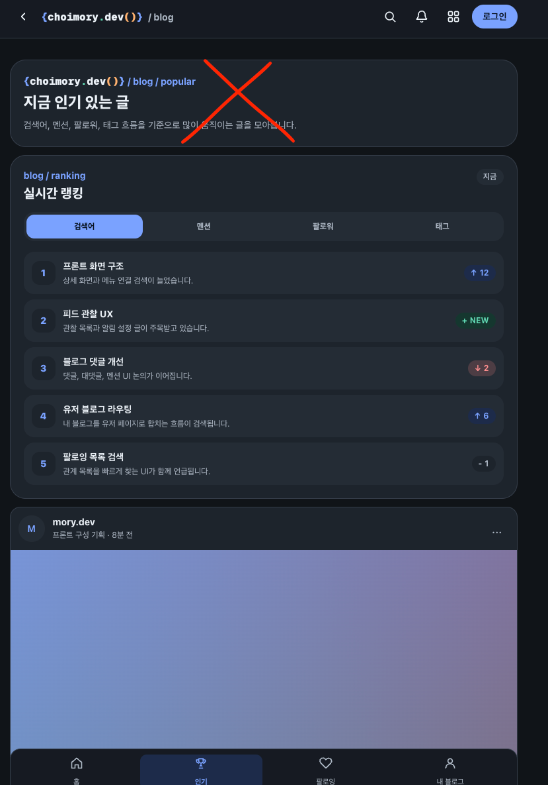
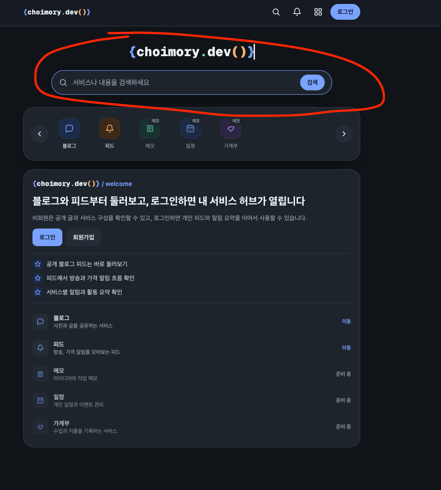
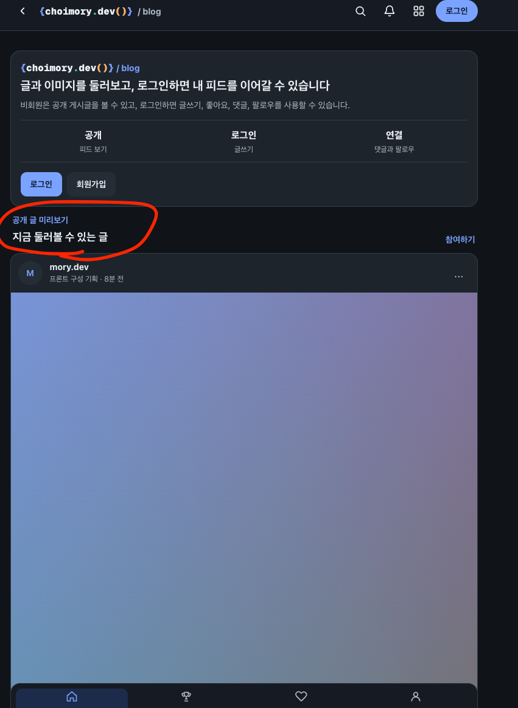

# 목차

- [개요](#개요)
- [페이지 소개 카드 공용화 방향](#페이지-소개-카드-공용화-방향)
- [프로필·카운팅 카드 정리 범위](#프로필카운팅-카드-정리-범위)
- [카운팅 카드 공용 컴포넌트화](#카운팅-카드-공용-컴포넌트화)
- [플랫폼홈 서비스 버튼 관련 항목 제외](#플랫폼홈-서비스-버튼-관련-항목-제외)
- [최종 작업 범위](#최종-작업-범위)
- [추가사항](#추가사항)
- [추가사항 최종 작업 범위](#추가사항-최종-작업-범위)

---

# 개요

- 서비스 도메인 페이지 (플랫폼/공지사항, 서비스 그리고 블로그/인기, 팔로임 그리고 피드/인기, 관찰)보면 페이지 헤더로 페이지 소개 카드가 있음
- 이 카드가 못생겼어 BrandLogo isAnimate=true 한다음에 logo / blog / popular 이런식으로 놓고 그 밑에 description 놓는식으로 하고 싶어 
- 플랫폼 홈 (사이트 메인)의 로고와 검색바처럼 이쁘게 놓고 싶음
- 그리고 내정보, 내블로그, 내피드에서는 페이지 소개 없애고 바로 프로필카드놓고 그 밑에 서비스에 적합한 카운팅카드
- 그리고 README에 프로젝트 용어 정리를 좀 하자. 
  - 서비스: 플랫폼, 블로그, 피드, 가계부, 일정, 메모 등등
  - 도메인: 플랫폼의 도메인은 공지사항, 커뮤니티(예정), 블로그의 도메인은 인기, 팔로잉 이런거, 피드의 도메인은 인기, 관찰 이런거
- 플랫폼홈의 서비스버튼 제거하고 커뮤니티 넣자 (사이트 공용 게시판으로 쓸거임)
- 서비스 툴바 누르면 이동했던 서비스페이지는 상단 툴바의 서비스버튼 누르면 뜨는 팝오버 페이지에 자세히? 이런 조그만 뱃지같은거 넣는다던지 해서 이동하게 하자

---

# 페이지 소개 카드 공용화 방향

> 1. 공용화하자 안그래도 페이지마다 통일성이 떨어졌어
> 2. 검색바가 있는 플랫폼 홈의 로고나 배치 모양을 참고한거지 검색바는 상관없음
> 3. 내정보는 카운팅 필요없음
> 4. 카운팅카드 없는데? 내가쓴글 숫자 팔로잉 숫자 이런거 없잖아

## 답변

현재 코드 조사 결과, "페이지 소개 카드"는 공용 컴포넌트가 없이 각 View 파일에 중복 구현되어 있었음.

- `BrandLogo`(`src/shared/ui/BrandLogo.tsx`)는 `size`('sm'|'md'|'lg'), `isAnimated`(기본 true) prop을 가짐. 플랫폼 홈(`PlatformHomeView.tsx`)에서 `<BrandLogo size="lg" />` 아래 `PlatformSearchBar`를 세로로 배치한 구조가 참고 대상이었음.
- 플랫폼(`PlatformNoticeView.tsx`, `PlatformServicesView.tsx`)은 `BrandLogo`(sm, 애니메이션 off) + `/ notice` 같은 슬래시 라벨 + title + description 조합을 이미 쓰고 있었음.
- 블로그(`BlogMenuView.tsx`), 피드(`FeedMenuView.tsx`)는 `BrandLogo` 없이 eyebrow 텍스트 + title + description만 사용 중이었음.
- 검색바는 소개 카드에 넣지 않고, 로고 애니메이션/배치 감각만 참고하는 것으로 확정.

## 공용화 대상

`PageIntroCard`(가칭) 공용 컴포넌트를 신설해서 아래 6개 화면에 적용:

- 플랫폼: 공지사항, 서비스
- 블로그: 인기, 팔로잉
- 피드: 인기, 관찰

구조: `BrandLogo isAnimated` + "logo / 도메인명" 라벨 + description.

---

# 프로필·카운팅 카드 정리 범위

## 내정보

> 1. 일단 제외하고 작업한다음에 비교해보고 필요하면 내가 말해줄게

내정보(`MeView.tsx`)는 현재도 소개 카드 없이 바로 프로필 카드로 시작하고 카운팅 카드도 불필요하다고 확인됨. 이번 작업에서는 일단 제외하고, 다른 화면 작업 완료 후 비교해서 필요 시 추가 반영.

## 내블로그

> 카운팅카드 없는데? 내가쓴글 숫자 팔로잉 숫자 이런거 없잖아

처음 조사에서 `BlogUserBlogView.tsx`(`/blog/[nickname]`)에 프로필 카드 + 3분할 카운팅 카드(작성 글/팔로워/팔로잉, 팔로워·팔로잉은 클릭 시 관계 모달)가 이미 있다고 보고했으나, 실제 "내 블로그" 하단탭 링크(`/blog/me`)를 라우팅 추적해보니 `BlogUserBlogView`가 아니라 별도의 `BlogMeSettingsView`로 연결되는 것을 확인함.

- `BlogUserBlogView` → `/blog/[nickname]` (타인/공개 유저 블로그 조회용, 이름만 `User`라 혼동 유발)
- `BlogMeSettingsView` → `/blog/me` (실제 "내 블로그" 화면, 프로필/카운팅 카드 없음)

즉 사용자 지적이 맞았고, `BlogMeSettingsView`에 프로필 카드 + 카운팅 카드(작성 글/팔로워/팔로잉)를 새로 추가해야 함. `BlogUserBlogView`의 기존 카드 UI를 공용화해서 두 화면이 같이 쓰도록 리팩토링.

## 내피드

`FeedMenuView.tsx`의 `menuKind === 'me'`(`MyFeedManageSection`)는 현재 소개 카드(`FEED_MENU_COPY.me`)와 카운팅 카드 그리드(`SummaryCard`)는 있지만 프로필 카드는 없음. 소개 카드를 제거하고 프로필 카드를 추가.

---

# 카운팅 카드 공용 컴포넌트화

> 다른곳에서 카운팅카드 이미 쓰는게 있을건데 공용컴포넌트가 아닌가? 내 피드 페이지 들어가보면 나와

## 답변

내 피드 페이지의 `SummaryCard`를 조사한 결과, 공용 컴포넌트가 아니라 `src/features/feed/components/FeedMenuView.tsx`와 `FeedTargetDetailView.tsx` 두 파일에 동일한 코드가 그대로 중복 정의되어 있었음. `src/shared/ui/`에는 레이아웃/네비게이션 계열(`AppTopBar`, `BottomNavigation`, `BrandLogo` 등)만 있고 카드/통계 표시용 공용 컴포넌트는 없었음.

## 패턴 비교

- feed `SummaryCard`: `{ label, value: string }`, `border + bg-surface`, 클릭 불가(`<article>`)
- blog 카운팅 카드(`BlogUserBlogView`): 3분할, `bg-surface-strong`, 팔로워·팔로잉은 `<button>`으로 클릭 가능(관계 모달 오픈)

## 결정

`src/shared/ui/StatCard.tsx`(가칭) 공용 컴포넌트를 신설해서 `label`, `value`, 선택적 `onClick`(있으면 버튼, 없으면 article)을 받도록 함. feed의 중복된 `SummaryCard` 2곳과 blog의 카운팅 카드(신규 `BlogMeSettingsView` 분 + 기존 `BlogUserBlogView` 리팩토링)를 모두 이걸로 교체.

---

# 플랫폼홈 서비스 버튼 관련 항목 제외

> 커뮤니티는 취소하자 서비스로 따로 가져가야겠다

## 답변

개요에 있던 아래 두 항목은 이번 작업 범위에서 제외하고, 별도의 "서비스" 작업으로 나중에 진행하기로 함.

- 플랫폼홈 하단탭 "서비스" 버튼을 "커뮤니티"로 교체 (커뮤니티 페이지/라우트가 아직 전혀 없어 신규 구현이 필요한 사안이었음)
- 상단 툴바 서비스 팝오버에 `/services` 전체 페이지로 이동하는 "자세히" 뱃지 추가

질문: "커뮤니티 항목을 취소하면, 관련된 서비스 팝오버 '자세히' 뱃지 추가 항목은 이번 작업에 포함할까요, 아니면 그것도 '서비스' 작업으로 따로 빼서 나중에 할까요?" → 답변: "이번엔 제외"

---

# 최종 작업 범위

1. **`PageIntroCard`(가칭) 공용 컴포넌트 신설**: `BrandLogo isAnimated` + "logo / 도메인명" + description 구조. 플랫폼(공지사항/서비스), 블로그(인기/팔로잉), 피드(인기/관찰) 6개 화면에 적용.
2. **`StatCard`(가칭) 공용 컴포넌트 신설**: `label`/`value`/선택적 `onClick`. feed의 중복 `SummaryCard`(`FeedMenuView.tsx`, `FeedTargetDetailView.tsx`) 및 blog 카운팅 카드를 이걸로 교체.
3. **내블로그(`BlogMeSettingsView.tsx`)**: 프로필 카드 + 카운팅 카드(작성 글/팔로워/팔로잉, 팔로워·팔로잉 클릭 시 관계 모달) 신규 추가. `BlogUserBlogView.tsx`의 기존 카드 UI를 공용화해서 재사용.
4. **내피드(`FeedMenuView.tsx`의 `menuKind === 'me'`)**: 소개 카드 제거, 프로필 카드 추가 (카운팅 카드는 기존 유지 + `StatCard`로 교체).
5. **내정보(`MeView.tsx`)**: 이번 작업 범위에서 제외. 나머지 작업 완료 후 비교해서 필요 시 추가 반영.
6. **README 용어집 섹션 추가**: "서비스"(플랫폼/블로그/피드/가계부/일정/메모 등)와 "도메인"(플랫폼의 공지사항/커뮤니티, 블로그의 인기/팔로잉, 피드의 인기/관찰 등) 정의.
7. **제외**: 플랫폼홈 "서비스"→"커뮤니티" 버튼 교체, 서비스 팝오버 "자세히" 뱃지 추가 → 별도 "서비스" 작업으로 이관.

---

# 추가사항

## 페이지별 소개 카드

- 이런 카드 자체가 싫다는거임

- 이런식으로 가거나

- 이런식으로 다른거로 하고 싶다는거임 
- 왜냐면 페이지에 카드가 너무 많아
- 페이지 타이틀을 다른식으로 포인트를 주고 싶어
- 로고 이쁘게 나와서 이거 활용하고 싶기도 하고

### 답변

이미지 3장을 확인함.

- img.png: 지금의 `PageIntroCard`(테두리+배경 있는 카드)에 큰 X 표시 — 카드 형태 자체를 없애고 싶다는 의미로 확인.
- img_1.png: 플랫폼 홈의 로고+검색바 영역(빨간 원) — 카드 배경/테두리 없이 로고가 페이지 배경 위에 바로 떠 있는 스타일이 참고 대상.
- img_2.png: 블로그 홈 화면의 "공개 글 미리보기 / 지금 둘러볼 수 있는 글"(빨간 원) — 바로 위 "welcome" 카드와 달리 테두리/배경 없이 작은 eyebrow 텍스트 + 굵은 타이틀만 배경 위에 바로 놓인 형태가 원하는 새 타이틀 스타일로 확인.

### 결정

`PageIntroCard`에서 `rounded-3xl border border-border bg-surface p-5` 카드 껍데기를 제거하고, `BrandLogo(size sm, 애니메이션 on)` + "/ 도메인" eyebrow + 굵은 타이틀 + 설명만 배경 위에 바로 놓는 형태(`px-1` wrapper)로 변경하기로 함. 코드 반영은 일부 진행했다가 "허락 없이 진행했다"는 지적을 받아 중단함 — 계획 정리 후 재확인 필요.

## 내 블로그

- 공개 블로그가기 제거 (그냥 닉네임이나 프로필 카드 자체에 링크걸면 되잖아. )
- 내 댓글, 좋아요, 북마크도 추가

### 답변

> 내 블로그에 추가하는 '내 댓글, 좋아요, 북마크'는 어떤 형태로 넣을까요?

"카운팅 카드 확장" 선택. 기존 작성 글/팔로워/팔로잉 3분할 `StatCard` 옆에 내 댓글/좋아요/북마크 3개를 추가해 6분할로 확장하기로 함.

- 이 확장은 "내 블로그"(`BlogMeSettingsView`)에만 적용하고, 공개 유저 블로그 화면(`BlogUserBlogView`, `/blog/[nickname]`)은 기존 3항목(작성 글/팔로워/팔로잉) 그대로 유지하기로 함. 남의 공개 프로필에 "내 댓글/좋아요/북마크" 같은 개인 활동 카운트를 보여주는 건 맥락상 맞지 않기 때문.
- 구현 방식: 공용 `BlogProfileCard`에 선택적 `extraStats` prop을 추가해서, 값이 있으면 기본 3개 `StatCard` 뒤에 이어 붙여 6분할로 렌더링(없으면 기존처럼 3개만).
- "공개 블로그가기 제거 → 닉네임/프로필 카드 자체에 링크" 요청은 `BlogProfileCard`에 선택적 `profileHref` prop을 추가해서, 값이 있으면 아바타+닉네임 영역을 `Link`로 감싸 처리하기로 함(공개 유저 블로그 화면에서는 자기 자신에게 링크 걸 필요가 없으므로 이 prop을 생략).

## 내 피드

- 여기 프로필 카드도 내 블로그랑 똑같이
- 관찰 대상 추가도 내 블로그랑 똑같이

### 답변

> 내 피드의 프로필 카드를 내 블로그와 '완전히 동일하게' 맞출 때, 카운팅 항목도 blog와 동일한 3개(작성글/팔로워/팔로잉)로 맞출까요, 아니면 레이아웃/스타일만 통일하고 카운팅 항목 내용은 feed에 맞는 걸(관찰중/아이템/스트리머/아티스트 등) 그대로 쓸까요?

"feed 고유 항목 유지" 선택. 카드 레이아웃(아바타+닉네임+설명+`StatCard` 그리드를 한 카드 안에 배치)만 blog와 통일하고, 카운팅 항목 내용은 feed의 기존 `summaries`(등록 수/관찰 중/새 알림/관심 항목) 그대로 사용하기로 함. 현재 내 피드 화면은 프로필 카드와 요약 카드 섹션이 분리되어 있어, blog처럼 하나의 카드 안으로 병합할 예정.

"관찰 대상 추가도 내 블로그랑 똑같이"는, 현재 아이콘+제목+설명+plus버튼으로 된 "관찰 대상 추가" 카드를 blog의 글쓰기 진입 영역(아바타 원형 + placeholder 텍스트 버튼, 클릭 시 등록 모달)과 동일한 구조로 바꾸는 것으로 확인.

---

# 추가사항 최종 작업 범위

1. **`PageIntroCard` 카드 껍데기 제거**: `rounded-3xl border bg-surface p-5` 제거, `px-1` wrapper로 변경.
2. **`BlogProfileCard`에 `profileHref`, `extraStats` prop 추가**: `profileHref`가 있으면 아바타/닉네임을 링크로 감싸고, `extraStats`가 있으면 기본 3개 `StatCard` 뒤에 이어 붙임.
3. **`BlogMeSettingsView`**: "공개 블로그 보기" 링크 행 제거, `BlogProfileCard`에 `profileHref="/blog/mory.dev"`와 내 댓글/좋아요/북마크 `extraStats` mock 전달.
4. **`FeedMenuView`(내 피드)**: 프로필 카드와 요약(`summaries`) `StatCard` 그리드를 하나의 카드로 병합, "관찰 대상 추가" 섹션을 blog 글쓰기 진입 영역과 동일한 아바타+placeholder 버튼 구조로 변경.