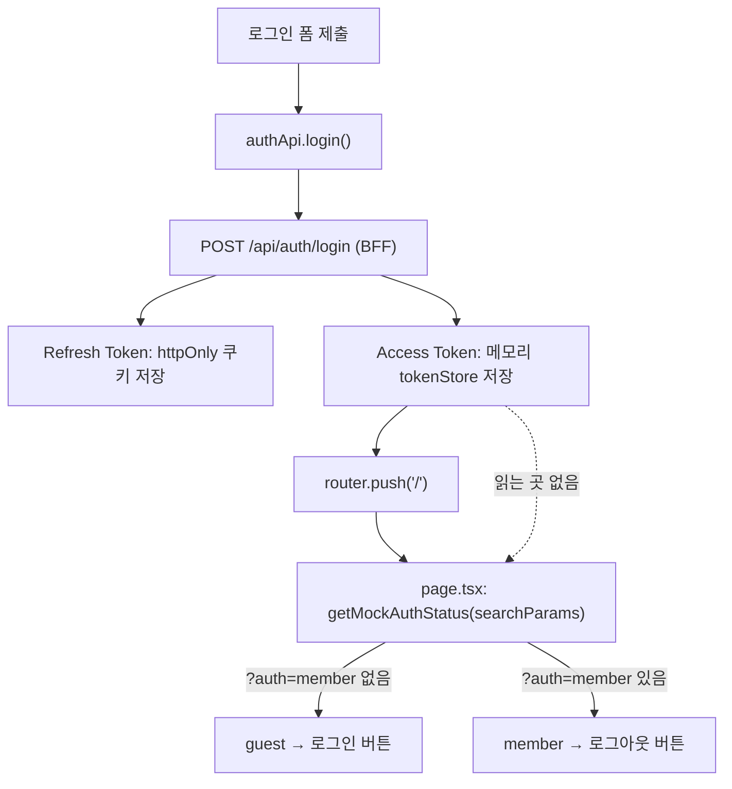
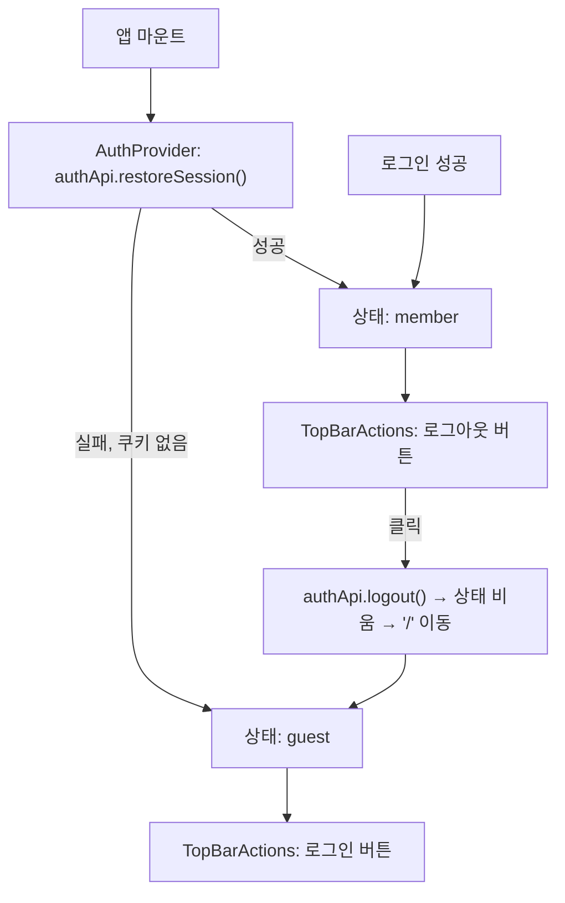
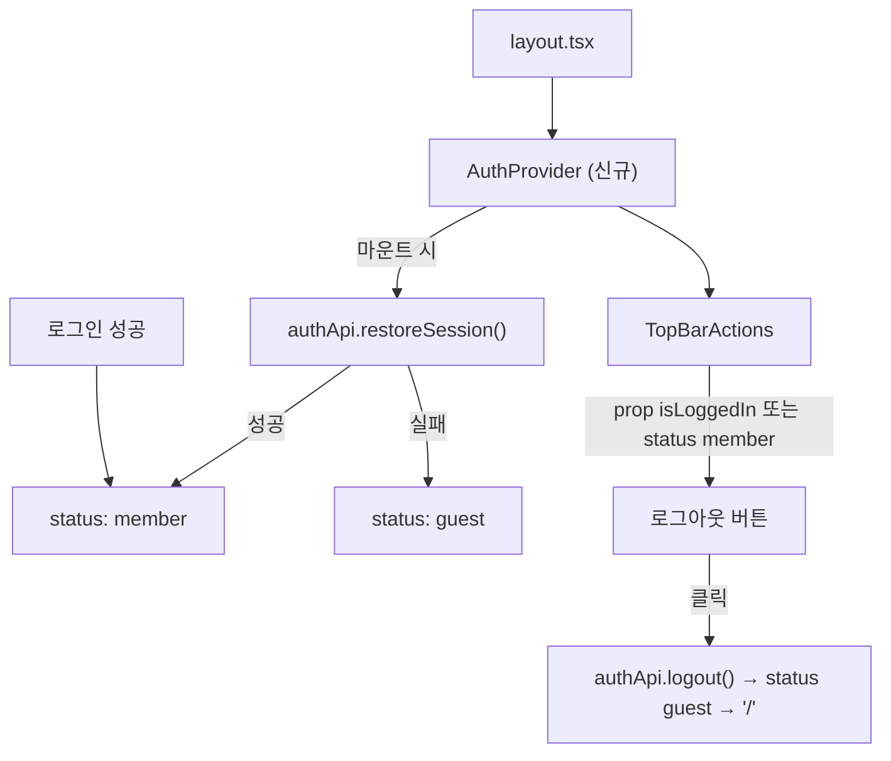
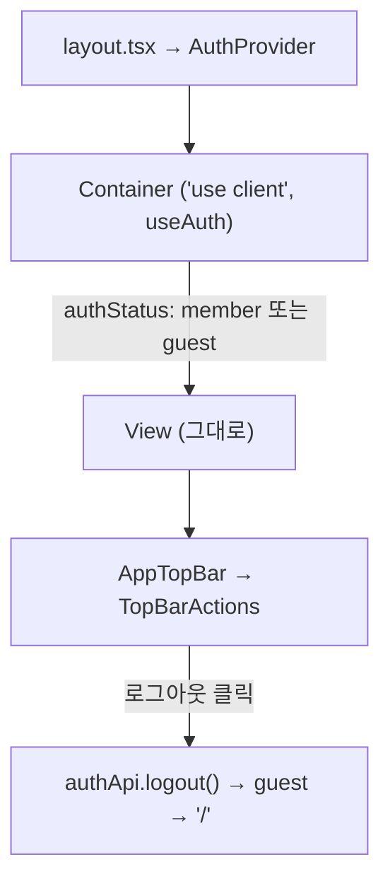

# 목차

- [개요](#개요)
- [로그인 상태 버튼 전환 버그 원인 분석](#로그인-상태-버튼-전환-버그-원인-분석)
  - [답변](#답변)
  - [버튼 전환 흐름](#버튼-전환-흐름)
  - [환경 차이 후보](#환경-차이-후보)
  - [다음 확인 계획](#다음-확인-계획)
- [로컬에서도 재현 확인, 수정 방향](#로컬에서도-재현-확인-수정-방향)
  - [답변](#답변-1)
  - [원인](#원인)
  - [수정 방향 후보](#수정-방향-후보)
  - [같이 정할 것](#같이-정할-것)
  - [진행 순서](#진행-순서)
- [local, stg 테스트 계정으로 토큰 상태 직접 분석](#local-stg-테스트-계정으로-토큰-상태-직접-분석)
  - [답변](#답변-2)
  - [테스트 계정](#테스트-계정)
  - [확인 결과](#확인-결과)
  - [토큰 상태 분석](#토큰-상태-분석)
  - [결론](#결론)
  - [남은 것](#남은-것)
- [작업 계획: 로그인 상태를 상단바 버튼에 반영](#작업-계획-로그인-상태를-상단바-버튼에-반영)
  - [답변](#답변-3)
  - [접근 방식](#접근-방식)
  - [변경 내용](#변경-내용)
  - [정해야 할 것](#정해야-할-것)
  - [범위 밖](#범위-밖)
  - [진행 절차](#진행-절차)
- [목업(?auth=member) 제거 결정과 수정된 계획](#목업authmember-제거-결정과-수정된-계획)
  - [답변](#답변-4)
  - [새로 확인된 사실](#새로-확인된-사실)
  - [수정된 계획](#수정된-계획)
  - [수정된 범위 밖](#수정된-범위-밖)
  - [수정된 진행 절차](#수정된-진행-절차)
- [결정이 필요한 선택지](#결정이-필요한-선택지)
  - [답변](#답변-5)
  - [1. isLoggedIn prop 전달 구조](#1-isloggedin-prop-전달-구조)
  - [2. 복원 중(loading) 화면](#2-복원-중loading-화면)
  - [3. 진행 방식](#3-진행-방식)
  - [결정 대기](#결정-대기)
- [결정 확정](#결정-확정)
  - [답변](#답변-6)
  - [확정 내용](#확정-내용)

---

# 개요

- 로그인 시 토큰이 저장되면서 로그인 버튼이 로그아웃 버튼으로 바뀌어야 한다.
- 로컬 환경에서는 정상 동작하지만, stg와 prod 환경에서는 버튼이 바뀌지 않는 버그가 있다.
- 로컬과 stg/prod의 차이(토큰 저장 방식, 쿠키/스토리지, 도메인, 환경변수, 빌드 설정 등)를 분석해 원인을 찾는다.
- stg: staging.choimory.dev, prd: choimory.dev 
- 계정은 테스트용 계정 가입해서 진행하고, paseo 브라우저 이용해서 직접 확인

---

# 로그인 상태 버튼 전환 버그 원인 분석

> 로그인시 토큰 저장되면서 로그인 버튼이 로그아웃 버튼으로 바뀌는게 로컬에선 잘되는데 stg, prod에선 안되는 버그가 있음

## 답변

코드 분석 결과, 환경 차이 문제가 아닐 가능성이 크다. 로그인 버튼 전환이 실제 토큰이 아니라 URL 쿼리(`?auth=member`)로 결정되기 때문이다. 아래 내용은 코드만 읽고 정리한 것이며, 브라우저 확인은 아직 하지 않았다.

## 버튼 전환 흐름

- 버튼은 `TopBarActions`의 `isLoggedIn`으로 전환된다. (`src/shared/ui/TopBarActions.tsx:119`)
- `isLoggedIn`은 각 페이지에서 `authStatus === 'member'`로 만들어진다. (예: `src/app/page.tsx:20`)
- `authStatus`는 `getMockAuthStatus(searchParams)`가 정한다. URL에 `?auth=member`가 있을 때만 `member`다. (`src/shared/model/mockAuth.ts`) 주석에 "실제 인증 연동 전까지 화면 확인에만 사용"이라고 적혀 있다.
- 로그인 성공 후에는 `router.push('/')`만 실행한다. (`src/features/auth/container/LoginContainer.tsx:18`) 쿼리가 없으므로 항상 guest 화면이 나온다.
- Access Token은 메모리(`src/shared/api/tokenStore.ts`)에만 저장되고, 어떤 화면도 이 토큰을 읽어 버튼을 바꾸지 않는다.
- `authApi.restoreSession()`은 정의만 있고 호출하는 곳이 없다.
- 로그아웃 버튼은 `/`로 이동하는 링크일 뿐이며 `authApi.logout()`을 호출하지 않는다.
- 로컬에서 잘 된다고 느낀 이유는 `?auth=member`를 붙여 확인했거나 다른 원인일 수 있어, 직접 확인이 필요하다.

## 환경 차이 후보

로그인 API 자체가 stg, prod에서 실패할 가능성도 따로 점검한다. (2순위)

### 쿠키 secure 옵션

- `src/shared/auth/refreshCookie.ts`는 `NODE_ENV === 'production'`이면 `secure: true`로 쿠키를 설정한다.
- stg, prod는 HTTPS라 문제없어 보이지만, 클러스터 안에서 TLS가 끝나고 앱까지 HTTP로 전달되면 쿠키 설정에 영향을 줄 수 있다.

### API 주소 환경변수

- `NEXT_PUBLIC_MEMBER_API_BASE_URL`은 빌드 때 GitHub Environment(stg, prod) 변수로 번들에 고정된다. (`.github/workflows/deploy.yml`, `Dockerfile`)
- `MEMBER_API_BASE_URL`은 서버 실행 시 GitOps overlay에서 주입한다. 이 저장소 밖에 있어 값을 확인할 수 없다.
- 둘 중 하나가 틀리면 stg, prod에서 로그인 API가 실패할 수 있다.

### env 파일

- `env/.env.dev`, `env/.env.prod`는 값이 비어 있다. 배포 이미지는 `APP_ENV` 없이 빌드하므로 영향은 없다.

## 다음 확인 계획

- 대상: `staging.choimory.dev` (stg와 prod가 동일한 현상이므로 stg만 진행), 테스트 계정은 stg에서만 가입
- 방법: paseo 브라우저로 직접 확인

1. 테스트 계정을 가입한다.
2. 로그인하면서 `/api/auth/login`의 응답 상태, `Set-Cookie` 헤더, 콘솔 에러를 확인한다.
3. 로그인 후 이동한 URL과 버튼 상태를 확인하고, `?auth=member`를 붙였을 때와 비교한다.
4. 로컬이 떠 있다면 같은 순서로 비교한다.

판단 기준은 다음과 같다.

- 로그인 API는 성공하는데 버튼만 안 바뀌면 코드 문제이며, 로컬에서도 같은 현상이 재현돼야 한다.
- 로그인 API가 실패하면 환경 설정 문제다.

---

# 로컬에서도 재현 확인, 수정 방향

> 아 그러네 로컬에서도 확인해봤는데 로그아웃 버튼으로 안바뀌는듯

## 답변

로컬에서도 같은 현상이므로 환경 차이 문제가 아니라 코드 문제로 확정한다. stg, prd에서 따로 확인할 필요가 없어져서 paseo 브라우저 확인과 stg 테스트 계정 가입은 하지 않기로 했다. 환경 차이 후보(쿠키 `secure` 옵션, API 주소)는 로그인 API 자체가 실패할 때만 의미가 있으므로 2순위로 남긴다.

## 원인

로그인 상태가 화면에 연결돼 있지 않다.

- 로그인하면 토큰은 저장된다. Refresh Token은 httpOnly 쿠키에, Access Token은 메모리에 들어간다.
- 상단바 버튼은 `?auth=member` 쿼리 목업으로만 바뀐다.
- 로그아웃 버튼은 `/`로 이동하는 링크일 뿐이다.

## 수정 방향 후보

### 1. 클라이언트 인증 상태 도입 (추천)

- 앱 전체에 `AuthProvider`를 두고, 마운트될 때 `authApi.restoreSession()`으로 쿠키의 Refresh Token에서 로그인 상태를 복원한다.
- 로그인에 성공하면 상태를 `member`로 바꾸고, `TopBarActions`는 이 상태를 읽어 버튼을 전환한다.
- 로그아웃 버튼은 `authApi.logout()`을 호출하고 상태를 비운 뒤 `/`로 이동한다.
- 장점: 기존 구조(Refresh Token은 httpOnly 쿠키, Access Token은 메모리)를 그대로 쓴다.
- 단점: 새로고침 직후 잠깐 깜빡일 수 있다. 복원이 끝날 때까지 버튼을 숨기거나 중립 상태로 두면 완화된다.

### 2. 서버에서 쿠키로 판단

- 페이지(서버 컴포넌트)가 쿠키를 읽어 로그인 여부를 정한다.
- 쿠키 경로가 `/api/auth`로 한정돼 있어 페이지에서는 쿠키가 보이지 않는다. 경로를 넓히면 보안 범위가 커진다.
- Refresh Token이 1회용이라, 쿠키 존재만으로 판단하면 만료나 폐기된 토큰을 구분하지 못한다.
- 깜빡임은 없지만 비추천.

### 3. 로그인 여부 표시용 쿠키를 별도로 추가

- httpOnly가 아닌 `logged_in` 같은 플래그 쿠키를 둔다.
- 구현은 가장 단순하지만 실제 토큰과 상태가 어긋날 수 있다.

## 같이 정할 것

- `?auth=member` 목업: 쓰이는 곳이 많아 완전히 지우면 기존 테스트와 컨테이너를 많이 고쳐야 한다. 상태 판단은 실제 인증으로 바꾸되 개발 확인용 override로 남기는 쪽을 추천한다.
- 범위: 이번에는 버튼 전환과 로그아웃까지만 하는 것을 추천한다. 로그인 사용자 정보(닉네임 등)와 보호 페이지 접근 제한은 따로 작업한다.

## 진행 순서

1. plan1에 결론과 선택한 방향을 기록한다.
2. 방향이 정해지면 calendar를 `TASK`로 바꾸고, `task1.md`에 구현 계획을 적은 뒤 코드를 수정한다.
3. 수정 후 `npm run lint`와 `npm run test:run`을 실행한다.
4. 마무리하면 `done1.md`를 쓰고 calendar를 `DONE`으로 바꾼다.

수정 방향은 아직 확정하지 않았다. (추천: 1번, 목업은 override로 유지, 범위는 버튼 전환과 로그아웃까지)

---

# local, stg 테스트 계정으로 토큰 상태 직접 분석

> 일단 local이랑 stg에 테스트계정 가입해서 관리자도구랑 코드 확인해서 직접 토큰상태 분석해봐. 로컬에도 현재 백엔드 띄워놨으니까 localhost:3000에서 가입가능함

## 답변

local과 stg 모두 같은 결과였다. 로그인 API와 토큰 저장은 정상이고, 로그인 상태를 화면에 반영하는 코드가 없어서 버튼이 바뀌지 않는다. 확인은 paseo 브라우저로 진행했으며, 코드는 수정하지 않았다.

## 테스트 계정

- 이메일: `tokentest01@example.com`
- 닉네임: `tokentest01`
- 비밀번호: `********` (마스킹)
- 가입 환경: local, stg (prd는 가입하지 않음)
- 계정은 local과 stg DB에 그대로 남아 있다. 필요하면 직접 삭제한다.

## 확인 결과

| 항목 | local (`localhost:3000`) | stg (`staging.choimory.dev`) |
|---|---|---|
| 가입 `POST /v1/member/join` | 201 | 201 |
| 로그인 `POST /api/auth/login` | 200 | 200 |
| 로그인 후 이동 | `/` | `/` |
| 상단 버튼 | 로그인 (안 바뀜) | 로그인 (안 바뀜) |
| `POST /api/auth/reissue` | 200, Access Token 발급 | 200, Access Token 발급 |
| `document.cookie` | 비어 있음 | 비어 있음 |
| localStorage, sessionStorage | 비어 있음 | 비어 있음 |
| `/?auth=member` 접속 | 로그아웃 (`/`로 이동하는 링크) | 로그아웃 (`/`로 이동하는 링크) |

- stg의 API 주소는 가입 요청이 `staging-member-api.choimory.dev`로 나간 것으로 확인했다.

## 토큰 상태 분석

- Refresh Token 쿠키는 정상 저장된다. `document.cookie`가 비어 있는 것은 httpOnly라서 JS에서 보이지 않기 때문이다. `reissue`는 쿠키가 있어야 성공하므로, 200 응답이 쿠키가 실제로 있다는 증거다.
- stg에서도 쿠키 `secure` 옵션이나 API 주소 문제는 없다. 환경 차이 후보는 모두 배제한다.
- Access Token은 메모리(`tokenStore`)에만 있고, 어떤 화면도 이 값을 읽지 않는다.
- 버튼은 `?auth=member` 쿼리 목업만 따른다.

## 결론

- 환경(local, stg, prd)과 무관하게 발생하는 코드 문제다.
- 로그인 상태를 화면에 반영하는 코드가 아직 없다. (실제 인증 연동 전의 목업이 그대로 남아 있음)
- 앞서 코드 분석으로 세운 가설이 실제 동작으로 확인됐다.

## 남은 것

- 수정 방향은 아직 확정하지 않았다. (추천: `AuthProvider`로 상태 복원, `?auth=member`는 개발용 override로 유지, 범위는 버튼 전환과 로그아웃까지)
- 방향이 정해지면 calendar를 `TASK`로 바꾸고 `task1.md`에 구현 계획을 쓴 뒤 코드를 수정한다.

---

# 작업 계획: 로그인 상태를 상단바 버튼에 반영

> 이제 무슨 작업을 할건지 계획 말해봐

## 답변

`isLoggedIn`을 페이지마다 prop으로 내려보내는 기존 구조는 그대로 두고, `TopBarActions`가 실제 로그인 상태를 직접 읽도록 바꾼다. 아직 착수 전이며, 승인 후 아래 순서로 진행한다.

## 접근 방식

- 판단 규칙: `isLoggedIn` prop(목업 포함) 또는 실제 인증 상태 중 하나라도 로그인이면 로그인으로 본다. 그래서 `?auth=member` override는 그대로 동작한다.
- 페이지 수십 개를 고치지 않고 상단바 한 곳에서 해결한다.

## 변경 내용

1. `AuthProvider`와 `useAuth` 신규 (`src/features/auth/` 아래)
   - 상태는 `loading`, `member`, `guest` 세 가지다.
   - 마운트될 때 `restoreSession()`을 한 번 호출한다. 쿠키가 없으면 `/api/auth/reissue`가 401을 돌려주고, 이 경우는 `guest`로 처리한다.
   - `markLoggedIn()`과 `logout()`을 제공한다.
2. `src/app/layout.tsx`: `{children}`을 `AuthProvider`로 감싼다.
3. `useLogin`: 로그인에 성공하면 `markLoggedIn()`을 호출한다. 로그인 뒤 `router.push('/')`는 클라이언트 이동이라 메모리 토큰이 유지된다.
4. `TopBarActions`
   - `useAuth()`로 상태를 읽어 버튼을 전환한다.
   - 로그아웃은 링크 대신 버튼으로 바꾼다. 클릭하면 `authApi.logout()`을 호출하고 `/`로 이동한다.
   - `loading` 동안은 버튼을 숨겨 새로고침 때 `로그인`이 잠깐 보이는 깜빡임을 막는다. 단 `?auth=member` override일 때는 바로 `로그아웃`을 보여준다.
5. 테스트
   - 신규: `AuthProvider` (복원 성공, 복원 실패, 로그인과 로그아웃 전환)
   - 수정: `tests/unit/shared/ui/TopBarActions.test.tsx` (`AuthProvider` 없이도 동작하는지 포함), `tests/unit/features/auth/container/LoginContainer.test.tsx`
   - 영향 확인: `tests/unit/shared/ui/AppTopBar.test.tsx`

## 정해야 할 것

1. `AuthProvider` 밖에서 렌더링할 때의 동작
   - 기존 테스트가 `AuthProvider` 없이 `TopBarActions`를 렌더링한다.
   - 추천: `useAuth`가 Provider가 없으면 `guest`를 돌려준다. 기존 테스트가 거의 그대로 통과한다.
2. 로그아웃 실패 처리
   - 추천: 서버 로그아웃이 실패해도 메모리 토큰과 쿠키는 지워지고(`authApi.logout`의 `finally`, BFF의 `finally`) 화면도 `guest`로 바꾼다. 로그아웃을 눌렀는데 로그인 상태로 남는 쪽이 더 나쁘다.
3. 복원 실패 시 로그인 화면으로 강제 이동하지 않는다. 비로그인 사용자도 공개 페이지를 볼 수 있어야 하기 때문이다.

## 범위 밖

- 로그인 사용자 정보(닉네임 등) 표시
- 보호 페이지 접근 제한
- 로그인 사용자가 `/login`에 접근할 때의 리다이렉트
- `?auth=member` 목업 제거

## 진행 절차

1. calendar를 `TASK`로 바꾸고 `task1.md`에 위 계획을 적는다.
2. 코드를 수정한다.
3. `npm run lint`와 `npm run test:run`을 실행한다.
4. local에서 paseo 브라우저로 로그인, 로그아웃, 새로고침 후 유지 여부를 확인한다.
5. 작업 내용을 설명한다. `done1.md`는 마무리를 요청받았을 때 작성한다.
6. stg 확인은 배포 후에 한다. 배포는 `stg` 브랜치에서 수동으로 실행하므로 제가 진행하지 않는다.

## 확인할 것

- 위 계획과 "정해야 할 것" 3가지 추천안대로 시작해도 되는지
- 브라우저 확인을 local에서만 할지, 배포 후 stg도 할지 (추천: 배포 후 확인만)

---

# 목업(?auth=member) 제거 결정과 수정된 계획

> ?auth=member 이거는 토큰 작업 전에 임시로 로그인화면/비로그인 화면 구분하려고 임시로 해놨던거니까 싹 지워버려도 됨
>
> 로그인이 구현되었으니까 ?auth=member는 없어지고 이제 실제 로그인과 토큰에 의한 처리로 변경되야함

## 답변

`?auth=member`는 완전히 제거하고, 로그인 상태는 실제 로그인과 토큰으로만 판단한다. 앞선 계획의 "목업을 개발용 override로 유지"안은 폐기한다. 목업 제거는 상단바 버튼뿐 아니라 페이지 내용까지 영향을 주므로 범위가 이전 계획보다 커진다.

## 새로 확인된 사실

- 홈, 블로그, 피드 화면은 로그인 여부에 따라 보여주는 섹션이 다르다. 예: `PlatformHomeView`는 로그인하면 `MemberServiceFeedSection`, 아니면 `GuestLandingSection`을 보여준다.
- 이 값(`viewModel.authStatus`)은 모두 `getMockAuthStatus`에서 나온다. 목업을 지우려면 버튼과 페이지 내용 둘 다 실제 인증 상태로 바꿔야 한다.
- 서버가 렌더링한 HTML은 쿠키를 읽을 수 없어 항상 guest다. 로그인한 사용자가 새로고침하면 복원이 끝날 때까지 guest 화면이 잠깐 보일 수 있다.
- `README.md:239`에 목업 설명이 있어 마무리 때 실제 동작에 맞게 고쳐야 한다.

영향 범위는 다음과 같다.

| 구분 | 규모 |
|---|---|
| `getMockAuthStatus`를 쓰는 `page.tsx` | 17개 |
| `authStatus`를 다루는 `src` 파일 | 40개 |
| `isLoggedIn`, `isMember`를 쓰는 `src` 파일 | 26개 |
| 영향받는 테스트 | 약 30개 (대부분 container, view 테스트) |

## 수정된 계획

1. `AuthProvider`, `useAuth` 신규: 마운트 때 `restoreSession()`으로 복원한다.
2. Container를 `'use client'`로 바꾸고 `authStatus` prop을 없앤다. 대신 `useAuth()` 결과로 `authStatus`를 만들어 View에 넘긴다.
3. `page.tsx` 17개에서 `searchParams`와 `getMockAuthStatus`를 제거한다. 페이지가 쿼리에 의존하지 않게 되어 정적 렌더링도 가능해진다.
4. `src/shared/model/mockAuth.ts`와 `tests/unit/shared/model/mockAuth.test.ts`를 삭제한다.
5. `TopBarActions`는 로그아웃 버튼 클릭 시 `authApi.logout()`을 호출한다.
6. `useLogin`은 성공 시 `markLoggedIn()`을 호출한다.
7. 테스트를 수정한다. Container 테스트는 `authStatus` prop 대신 `AuthProvider`나 `useAuth` mock으로 바꾼다. View 테스트는 거의 그대로 둔다.
8. 마무리할 때 `README.md`의 목업 설명을 고친다.

## 수정된 범위 밖

- 로그인 사용자 정보(닉네임 등) 표시
- 보호 페이지 접근 제한
- 로그인 사용자의 `/login` 접근 리다이렉트
- `isLoggedIn` prop 제거 (아래 선택지 1에서 가를 선택 시 후속 작업)

## 수정된 진행 절차

1. calendar를 `TASK`로 바꾸고 `task1.md`에 계획을 적는다.
2. 코드를 수정한다.
3. `npm run lint`와 `npm run test:run`을 실행한다.
4. local에서 paseo 브라우저로 확인한다. 로그인 후 버튼과 홈 내용이 바뀌는지, 새로고침 후에도 유지되는지, 로그아웃이 되는지를 본다.
5. 작업 내용을 설명한다. `done1.md`와 `README.md` 반영은 마무리를 요청받았을 때 한다.

---

# 결정이 필요한 선택지

> 추천안 외에 선택지는 어디갔어
>
> 텍스트로 해줘

## 답변

추천안만 제시하고 대안을 빼 버려서 선택지를 다시 정리했다. 선택창(AskUserQuestion)은 닫혀서 글로 정리했다.

## 1. isLoggedIn prop 전달 구조

- 가 (추천): 지금 구조를 유지한다. Container가 `useAuth()`로 실제 상태를 만들어 View와 상단바에 넘긴다. View 테스트가 거의 안 바뀌고 변경이 Container와 `page.tsx`에 모인다. prop 제거는 후속 작업이다.
- 나: `TopBarActions`가 `useAuth()`를 직접 읽고 `isLoggedIn` prop을 View 26개에서 모두 없앤다. 구조는 깔끔하지만 View와 테스트가 같이 바뀌어 변경 범위가 훨씬 크다.
- 다: `TopBarActions`만 `useAuth()`를 직접 읽고 페이지 내용(guest, member 섹션)은 Container가 넘긴 값을 쓴다. 버튼과 내용이 같은 상태를 보지만 prop이 일부만 남아 구조가 어중간하다.

## 2. 복원 중(loading) 화면

- 가 (추천): `loading`을 guest로 취급해서 렌더링한다. 구현이 가장 단순하고, 로그인한 사용자가 새로고침하면 guest 화면이 잠깐 보인다. 깜빡임은 이후 스켈레톤으로 개선한다.
- 나: 복원 중에는 내용 영역을 스켈레톤으로 대신한다. 깜빡임은 없지만 모든 페이지에 스켈레톤이 필요하고, 비로그인 사용자도 매번 잠깐 스켈레톤을 본다.
- 다: 내용은 guest로 보여주고 상단바 버튼만 복원이 끝날 때까지 숨긴다. 버튼 깜빡임은 막지만 내용 깜빡임은 남는다.

## 3. 진행 방식

- 가 (추천): 한 번에 진행하되 단계마다 `lint`와 `test:run`을 돌려 깨진 곳을 바로 잡는다.
- 나: 2단계로 나눈다. 1단계는 `AuthProvider`와 상단바 버튼 전환까지, 2단계는 Container와 `page.tsx`의 목업 제거다. 단계마다 확인받아 안전하지만 시간이 더 걸린다.
- 다: 목업 제거부터 먼저 하고 실제 인증 연결을 이어서 한다. 중간에 로그인 화면이 항상 guest로 보이는 상태가 생긴다.

## 결정 대기

- 위 3가지는 아직 선택하지 않았다. (추천: 1-가, 2-가, 3-가)
- 선택이 정해지면 plan1에 결정 내용을 기록하고, calendar를 `TASK`로 바꾼 뒤 `task1.md`부터 시작한다.

---

# 결정 확정

> 추천대로 해주고 니가 필요한만큼 하위 에이전트 gpt sol 6.2 불러서 병렬 진행해줘

## 답변

선택지 3가지를 추천안으로 확정하고 구현을 시작한다. 하위 에이전트를 병렬로 투입해 진행한다.

## 확정 내용

- 1-가: `isLoggedIn` prop 전달 구조를 유지한다. Container가 `useAuth()`로 실제 상태를 만들어 View와 상단바에 넘긴다.
- 2-가: 복원 중(`loading`)은 guest로 취급해서 렌더링한다.
- 3-가: 한 번에 진행하되 단계마다 `lint`와 `test:run`으로 검증한다.
- 이전에 추천했던 세부 사항도 함께 확정한다. `AuthProvider` 밖에서는 `guest`로 처리하고, 로그아웃이 실패해도 화면은 `guest`로 바꾸며, 복원 실패 시 로그인 화면으로 강제 이동하지 않는다.
- 하위 에이전트 병렬 작업은 `task1.md`에 분담 내용을 기록한다.
