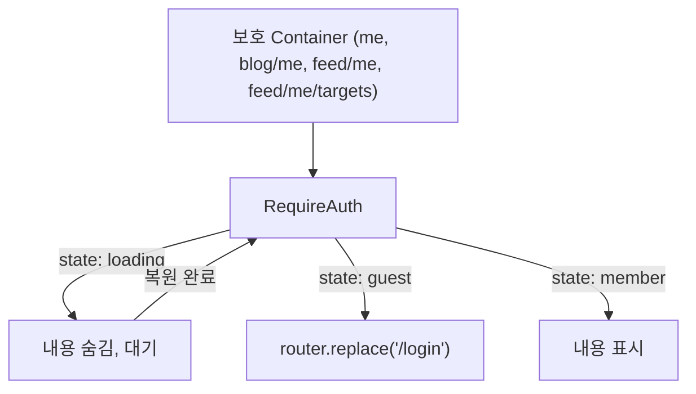
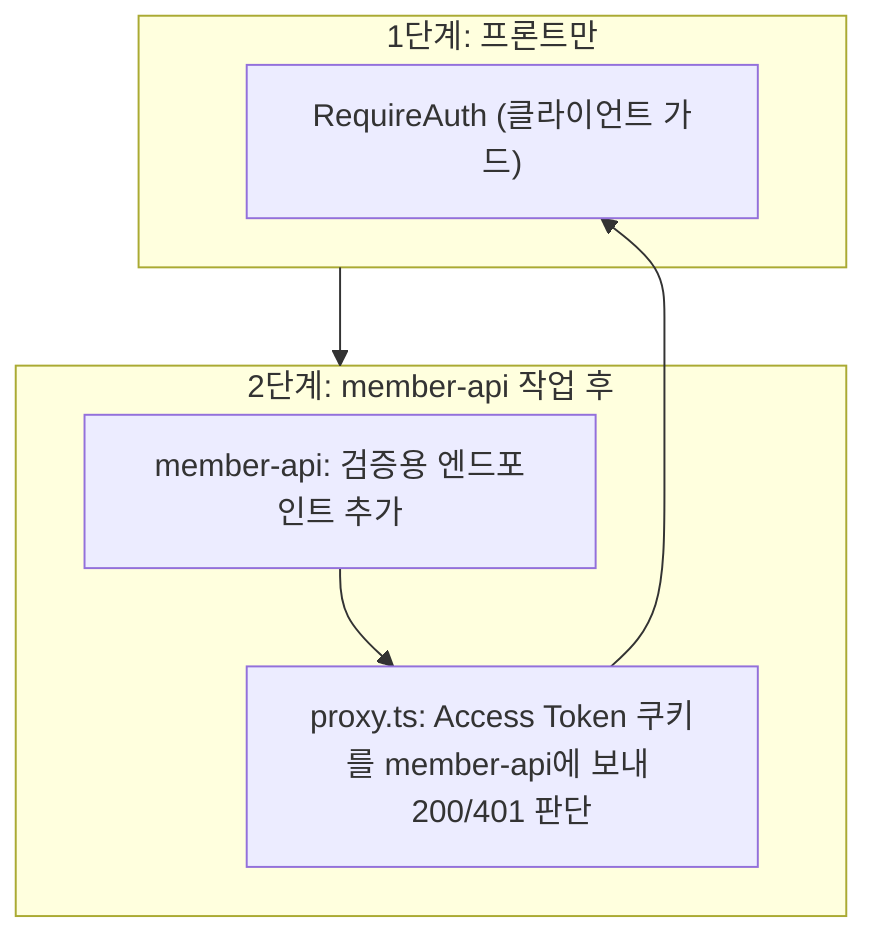

# 목차

- [개요](#개요)
- [로그인 필요 페이지 접근 제한](#로그인-필요-페이지-접근-제한)
  - [답변](#답변)
  - [현상과 원인](#현상과-원인)
  - [보호 대상 후보](#보호-대상-후보)
  - [접근 제한 방식 선택지](#접근-제한-방식-선택지)
  - [같이 정할 것](#같이-정할-것)
  - [작업 계획 (추천안 기준)](#작업-계획-추천안-기준)
  - [결정 대기](#결정-대기)
- [프록시가 제일 안전한가](#프록시가-제일-안전한가)
  - [답변](#답변-1)
  - [프록시가 나은 점](#프록시가-나은-점)
  - [지금 구조에서 바로 못 쓰는 이유](#지금-구조에서-바로-못-쓰는-이유)
  - [당시 제시한 선택지 (이후 정정됨)](#당시-제시한-선택지-이후-정정됨)
- [member-api 서버 종류](#member-api-서버-종류)
  - [답변](#답변-2)
  - [확인 근거](#확인-근거)
  - [보안 검증의 위치](#보안-검증의-위치)
- [토큰 조작 방어와 프록시 검증](#토큰-조작-방어와-프록시-검증)
  - [답변](#답변-3)
  - [이전 설명 정정](#이전-설명-정정)
  - [클라이언트 가드를 조작하면 노출되는 범위](#클라이언트-가드를-조작하면-노출되는-범위)
  - [프록시 검증의 선결 문제](#프록시-검증의-선결-문제)
  - [프록시 검증 선택지](#프록시-검증-선택지)
  - [단계 진행 제안](#단계-진행-제안)
  - [결정 대기 (프록시 검증 논의 후)](#결정-대기-프록시-검증-논의-후)
- [최종 추천](#최종-추천)
  - [답변](#답변-4)
  - [1단계: 지금 바로 (프론트만)](#1단계-지금-바로-프론트만)
  - [2단계: member-api 작업 후 (서버 검증)](#2단계-member-api-작업-후-서버-검증)
  - [추천 이유](#추천-이유)
  - [선택 요약](#선택-요약)
- [결정 확정 (단계 진행)](#결정-확정-단계-진행)
  - [답변](#답변-5)
  - [확정 내용](#확정-내용)
  - [1단계 작업 범위 (착수 전)](#1단계-작업-범위-착수-전)
  - [후속 작업](#후속-작업)
  - [미정 항목](#미정-항목)

---

# 개요

- plan1, task1에서 `?auth=member` 목업을 제거하고 실제 로그인과 토큰으로 상단바 버튼과 화면을 전환했다.
- 로그인한 사용자만 볼 수 있어야 하는 페이지(내 정보, 내 블로그, 내 피드)가 비로그인 상태에서도 열린다.
- 비로그인으로 열리면 상단바 버튼이 `로그아웃`으로 나오는 문제도 있다.
- 비로그인 사용자가 이 페이지에 진입하면 로그인 화면으로 이동시켜야 한다.
- 같은 작업 디렉토리(`login-state-stg-prod-bug`)의 plan2로 이어서 작성한다.
- 참고: plan1, task1, Next.js 16 문서(`node_modules/next/dist/docs/01-app/01-getting-started/16-proxy.md`, `01-app/02-guides/authentication.md`)

---

# 로그인 필요 페이지 접근 제한

> 다음으로 내정보/내블로그/내피드 이 페이지는 비로그인시 진입 막고 로그인화면으로 이동시켜야하는데, 비로그인시에도 진입 가능하고 위의 로그인버튼이 로그인 안했는데도 로그아웃으로 나옴

## 답변

코드를 읽어 원인을 확인했다. 두 현상은 서로 다른 원인이다. 아직 코드는 수정하지 않았고, 아래 선택지를 정한 뒤 구현한다.

## 현상과 원인

### 1. 비로그인인데 `로그아웃` 버튼이 나온다

- `/me`의 `MeView`가 상단바에 `isLoggedIn`을 항상 켠 채로 넘긴다. (`src/features/me/components/MeView.tsx:51`, `<AppTopBar isLoggedIn />`)
- `MeContainer`는 `useAuth()`를 쓰지 않아서 실제 로그인 상태가 반영되지 않는다.
- `/blog/me`, `/feed/me`, `/feed/me/targets/[targetId]`는 task1에서 실제 상태를 쓰도록 바꿨으므로 버튼은 맞게 나온다.

### 2. 비로그인으로도 페이지가 열린다

- 접근을 막는 코드가 어디에도 없다. `proxy.ts`(Next.js 16의 Middleware 후속)와 `middleware.ts`가 모두 없다.
- 화면 컴포넌트는 로그인 여부와 상관없이 그대로 그려진다.

### 3. 서버에서 막기 어려운 이유

- Refresh Token 쿠키의 경로가 `/api/auth`로 한정돼 있다. (`src/shared/auth/refreshCookie.ts`) 브라우저는 이 쿠키를 `/me` 같은 페이지 요청에는 보내지 않는다. 그래서 `proxy.ts`가 페이지 요청에서 로그인 여부를 알 수 없다.
- Access Token은 메모리에만 있어 서버가 볼 수 없다.
- Next.js 문서도 Proxy는 쿠키만 읽는 낙관적 체크(optimistic check) 용도이고, 전체 세션 관리나 권한 검사를 대신하면 안 된다고 안내한다.

### 4. 로그인 복원 중 처리

- 새로고침하면 `AuthProvider`가 복원을 끝낼 때까지 상태가 `loading`이다. 이때 곧바로 `guest`로 보고 로그인 화면으로 보내면, 로그인한 사용자도 새로고침할 때마다 쫓겨난다.
- 따라서 `loading`일 때는 이동하지 않고 기다려야 한다.

## 보호 대상 후보

사용자가 말한 대상은 내 정보, 내 블로그, 내 피드다.

| 경로 | 화면 | 현재 |
|---|---|---|
| `/me` | 내 정보 | `isLoggedIn` 항상 true, 접근 제한 없음 |
| `/blog/me` | 내 블로그 설정, 관리 | 접근 제한 없음 |
| `/feed/me` | 내 피드 | 접근 제한 없음 |
| `/feed/me/targets/[targetId]` | 내 피드 target 설정 | 접근 제한 없음 |

확인이 필요한 경로는 다음과 같다. (사용자가 지정하지 않았으므로 기본은 제외)

- `/blog/following`: 팔로잉 목록이라 로그인 전제일 수 있다.
- `/feed/observations`, `/feed/observations/[observationId]`, `/feed/activities/[activityId]`: 내 관찰 목록과 활동일 수 있다.
- `/feed/popular`, `/blog/popular`: 공개 목록이라 제외가 맞아 보인다.

## 접근 제한 방식 선택지

### 가 (추천): 클라이언트 가드

- `useAuth()` 상태로 판단하는 가드 컴포넌트(`RequireAuth`)를 만들어 보호 대상 Container에 적용한다.
- 동작: `loading`이면 내용을 숨기고 기다린다. `guest`가 되면 `router.replace('/login')`으로 이동한다. `member`이면 내용을 보여준다.
- 장점
  - 지금 구조(Access Token은 메모리, Refresh Token은 `/api/auth` 한정 쿠키)를 바꾸지 않는다.
  - 새로고침 후 복원 결과를 정확히 반영한다.
  - 로그아웃하면 곧바로 로그인 화면으로 보낼 수 있다.
- 단점
  - 서버가 만든 HTML에는 보호 화면의 마크업이 들어 있다. 지금은 목업 데이터라 문제가 없지만, 실제 데이터가 생기면 데이터는 API가 Bearer 토큰으로 막아야 한다. 화면 가드는 UX 용도다.
  - 복원이 끝날 때까지 잠깐 빈 화면(또는 로딩)이 보인다.

### 나: 서버 Proxy

- `proxy.ts`에서 쿠키를 보고 `/login`으로 redirect한다.
- 이렇게 하려면 쿠키 변경이 필요하다. Refresh Token 쿠키 경로를 `/`로 넓히거나, 로그인 표시용 쿠키(`logged_in` 등)를 따로 추가해야 한다.
- 장점: 깜빡임 없이 서버에서 바로 막고, 보호 화면 HTML이 내려가지 않는다.
- 단점
  - Refresh Token 쿠키가 모든 요청에 실려서 노출 범위가 커진다. (경로를 넓히는 경우)
  - 표시용 쿠키는 실제 토큰과 어긋날 수 있다. 만료나 폐기된 토큰을 구분하지 못한다.
  - Next.js 문서가 말하는 낙관적 체크에 그치므로 어차피 클라이언트나 API 검증이 필요하다.

### 다: 가 + 나 병행

- 서버 Proxy가 첫 진입을 막고, 클라이언트 가드가 복원 결과와 로그아웃을 보강한다.
- 가장 견고하지만 쿠키 변경과 가드 구현이 모두 필요해서 범위가 가장 크다.

## 같이 정할 것

1. 로그인 후 돌아갈 곳
   - 가 (추천): 이번에는 단순히 `/login`으로 보낸다. 로그인 성공 후에는 지금처럼 `/`로 이동한다.
   - 나: `/login?next=/me`처럼 원래 페이지를 기억했다가 로그인 후 돌아간다. 사용자 경험은 좋지만 `next` 값 검증(외부 URL 방지)이 필요하다.
2. 복원 중(`loading`) 화면
   - 가 (추천): 내용 영역을 비워 둔다. 구현이 가장 단순하다.
   - 나: 스켈레톤을 보여준다. 보호 페이지가 4개뿐이라 부담은 적지만 디자인 작업이 필요하다.
3. 보호 대상 범위
   - 가 (추천): 말씀하신 4개 경로(`/me`, `/blog/me`, `/feed/me`, `/feed/me/targets/[targetId]`)만 한다.
   - 나: 위 확인 필요 경로까지 포함한다. 어떤 경로가 로그인 전용인지 정해 주셔야 한다.
4. `/me` 상단바 버튼
   - 가 (추천): `MeContainer`가 `useAuth()`로 읽어 `isLoggedIn`을 넘긴다. 다른 Container와 같은 방식이다.
   - 나: `AppTopBar`의 `isLoggedIn`을 `MeView`에서 제거하고 기본값을 쓴다. 보호 화면은 로그인 사용자만 보므로 항상 로그아웃이 맞다. 다만 `AuthProvider` 밖에서는 로그아웃 버튼이 잘못 나올 수 있다.

## 작업 계획 (추천안 기준)

추천안은 방식 가, 같이 정할 것 1-가, 2-가, 3-가, 4-가다.

1. `RequireAuth` 신규 (`src/features/auth/components/`)
   - `useAuth()`의 `state`를 읽는다. `loading`이면 `null`, `guest`이면 `router.replace('/login')` 호출 후 `null`, `member`이면 `children`.
   - 이동은 `useEffect`에서 한 번만 실행한다.
2. 보호 Container 4개에 적용
   - `MeContainer`: `useAuth()`로 `isLoggedIn`을 읽어 `MeView`에 넘기고, 내용은 `RequireAuth`로 감싼다. `MeView`의 `<AppTopBar isLoggedIn />` 하드코딩은 prop으로 바꾼다.
   - `BlogMeSettingsContainer`, `FeedTargetSettingsContainer`: `RequireAuth`로 감싼다.
   - `FeedMenuContainer`: `menuKind === 'me'`일 때만 감싼다. 같은 Container를 `/feed/popular`와 `/feed/observations`도 쓰므로 공개 경로는 건드리지 않는다.
3. 테스트
   - 신규: `RequireAuth` (loading 대기, guest 이동, member 표시, 복원이 늦게 끝나는 경우)
   - 수정: 보호 Container 테스트 4개 (guest일 때 `/login`으로 이동하고 내용이 안 보이는지, member일 때 보이는지), `MeView`와 `MeContainer` 테스트
4. 확인할 위험
   - 보호 페이지에서 로그아웃을 누르면 `logout()`이 `guest`로 바꿔 가드가 `/login`으로 보내고, 이어서 `TopBarActions`가 `router.push('/')`를 실행한다. 최종 도착지가 `/`인지 `/login`인지 브라우저에서 확인한다. 의도는 로그아웃 후 홈이다.
   - 로그인한 사용자가 `/me`를 새로고침했을 때 `/login`으로 쫓겨나지 않는지 확인한다.
5. 검증
   - `npx tsc --noEmit`, `npm run lint`, `npm run test:run`
   - local에서 paseo 브라우저로 확인한다. 비로그인으로 4개 경로 진입 시 `/login` 이동, 로그인 후 4개 경로 접근, 새로고침 유지, 로그아웃 이동을 본다.
6. 후속 작업 후보
   - 실제 데이터가 연동되면 API가 401로 막는지 확인한다. (화면 가드는 UX 용도)
   - 방식 나나 다를 하려면 쿠키 설계를 별도로 논의한다.

## 결정 대기

- 방식(가, 나, 다)과 같이 정할 것 4가지는 아직 선택하지 않았다. (추천: 방식 가, 1-가, 2-가, 3-가, 4-가)
- 선택이 정해지면 plan2에 결정을 기록하고, `task2.md`에 구현 계획을 적은 뒤 코드를 수정한다.

---

# 프록시가 제일 안전한가

> 프록시 (미들웨어) 가 제일 안전하지않나

## 답변

맞는 부분이 있다. 서버에서 막으면 보호 화면의 HTML이 비로그인 사용자에게 내려가지 않고, 로딩 중 빈 화면이나 깜빡임도 없다. 그래서 추천을 클라이언트 가드(가)에서 서버 프록시를 포함하는 쪽(다, 병행)으로 바꿨다. 다만 "가장 안전하다"까지는 아니고, 지금 구조로는 바로 쓸 수 없다. (이 답변의 쿠키 설계는 아래 "토큰 조작 방어와 프록시 검증"에서 정정됨)

## 프록시가 나은 점

- 비로그인 사용자에게 보호 화면의 마크업이 내려가지 않는다.
- 복원이 끝날 때까지 빈 화면을 보여주는 과정이나 깜빡임이 없다.
- 첫 진입을 서버에서 바로 `/login`으로 보낸다.

## 지금 구조에서 바로 못 쓰는 이유

- Refresh Token 쿠키 경로가 `/api/auth`로 한정돼 있어서, 브라우저가 `/me` 같은 페이지 요청에는 이 쿠키를 보내지 않는다. 프록시가 로그인 여부를 알 수 없다. (`src/shared/auth/refreshCookie.ts`)
- Next.js 문서는 프록시를 쿠키만 읽는 낙관적 체크 용도로만 쓰라고 하고, 전체 세션 관리나 권한 검사를 대신하면 안 된다고 안내한다.
- 실제 데이터를 지키는 것은 Bearer 토큰을 검사하는 API다. 지금 보호 화면은 목업 데이터라 HTML이 노출돼도 민감한 정보는 없다.

## 당시 제시한 선택지 (이후 정정됨)

아래는 이 시점에 제시한 선택지다. 1번의 "표시용 쿠키"는 사용자가 직접 만들어 넣을 수 있어 토큰 조작을 막지 못한다는 것이 다음 질문에서 확인되어 폐기한다.

1. 프록시가 볼 쿠키 설계
   - 가 (당시 추천): 로그인 표시용 쿠키(`logged_in=1`, 경로 `/`, httpOnly, 수명은 Refresh Token과 같게)를 따로 추가한다. 로그인과 재발급 때 설정하고 로그아웃과 재발급 실패 때 지운다. (폐기)
   - 나: Refresh Token 쿠키 경로를 `/`로 넓힌다. Refresh Token이 정적 파일까지 모든 요청에 실려 노출 범위가 커져서 비추천.
2. 프록시만 쓸지, 클라이언트 가드도 둘지
   - 가 (추천): 병행한다. 표시용 쿠키가 남아 있는데 Refresh Token이 이미 만료되거나 폐기된 경우를 클라이언트 가드가 보강한다.
   - 나: 프록시만 둔다. 상단바 버튼과 화면이 어긋날 수 있다.
3. 프록시 matcher 범위
   - 가 (추천): 보호 경로만 지정한다. (`/me`, `/blog/me`, `/feed/me`, `/feed/me/targets/*`)
   - 나: 전체 경로에서 실행하고 코드로 분기한다.
4. 로그인 후 돌아갈 곳
   - 가 (추천): 이번에는 `/login`으로만 보낸다.
   - 나: `/login?next=/me`로 원래 페이지를 기억한다. `next` 값 검증(오픈 리다이렉트 방지)이 필요하다.

---

# member-api 서버 종류

> api는 nestjs 서버 말하는거야?

## 답변

아니다. "API"는 `member-api`(`choimory-dev-member-api`)를 말한 것이고, 이 서버는 NestJS가 아니라 Java Spring Boot다. `.agents/rules/back-end/nestjs/`에 NestJS 규칙 문서가 있지만 `member-api`와는 무관하다. `sender-queue`는 확인하지 않았다.

## 확인 근거

- 형제 디렉토리 `../choimory-dev-member-api/build.gradle`에 `org.springframework.boot` 3.5.4 플러그인이 있다.
- `gradlew`, `build.gradle`이 있는 Gradle 프로젝트다.
- 규칙 문서는 `.agents/rules/back-end/springboot/code-convention.md`(Java, Springboot, JPA)와 `nestjs/code-convention.md`(TypeScript, NestJS, TypeORM)가 모두 있다.

## 보안 검증의 위치

- 보호 화면의 데이터를 실제로 막는 쪽은 `member-api`다. 프론트는 로그인 후 받은 Access Token을 `Authorization: Bearer ...`로 보내고, 서버가 서명을 검증해 없거나 만료되면 401(`TOKEN_EXPIRED` 등)을 돌려준다.
- 지금은 보호 화면이 프론트 목업 데이터를 써서 서버가 막을 데이터가 아직 없다. 실제 데이터를 붙일 때 해당 엔드포인트에 인증이 걸려 있는지 `member-api`에서 확인해야 한다.

---

# 토큰 조작 방어와 프록시 검증

> 니가 말하는건 토큰체크를 그냥 페이지에 넣겠다는거 아냐? 그럼 브라우저에서 토큰조작하면 뚫리잖아 나는 그래서 nestjs 서버 이용해서 proxy 같은곳에 토큰검증을 넣어야 토큰조작으로 뚫는일이 없지 않겠냐 하는거임

## 답변

지적이 맞다. 클라이언트 가드는 UX 용도라 브라우저에서 조작할 수 있고, 앞서 제안한 표시용 쿠키 방식도 쿠키를 직접 만들어 넣으면 통과한다. 토큰 조작을 막으려면 서버가 토큰을 서명까지 검증해야 한다. NestJS 서버는 이 프로젝트에 없으므로, 말씀하신 것을 Next.js 서버의 `proxy.ts`에서 검증하는 것으로 이해했다. (별도 NestJS 서버를 두려는 의도인지는 확인 필요)

## 이전 설명 정정

- 프록시가 표시용 쿠키(`logged_in=1`)만 확인하는 방식은 안전하지 않다. 위조가 가능하므로 "프록시가 가장 안전하다"는 설명은 이 방식에는 해당하지 않는다.
- 프록시가 안전하려면 쿠키 존재가 아니라 토큰의 서명과 만료를 검증해야 한다.

## 클라이언트 가드를 조작하면 노출되는 범위

- 브라우저에서 화면 상태를 조작하면 보호 화면의 껍데기는 볼 수 있다. 지금은 목업 데이터라 볼 수 있는 실제 정보는 없다.
- 실제 데이터는 `member-api`가 Bearer 토큰의 서명을 검증하므로 위조 토큰으로는 받을 수 없다.
- 단, 현재 `member-api` OpenAPI 문서에는 `POST /v1/member/join`, `POST /v1/member/reissue`, `POST /v1/login`, `POST /v1/logout` 4개뿐이고 인증이 필요한 조회 API가 아직 없다. 보호 화면에 실제 데이터를 붙일 때 서버 검증을 확인해야 한다.

## 프록시 검증의 선결 문제

1. 프록시는 Access Token을 볼 수 없다. 지금은 메모리에만 있고 페이지 요청에는 실리지 않는다. 쿠키에도 저장해야 하며, 이 쿠키는 페이지 접근 판단에만 쓰고 API 인증에는 쓰지 않으므로 CSRF 위험은 늘지 않는다.
2. 서명 검증 방법이 두 가지이고, 둘 다 `member-api`에 필요한 것이 있다. (아래 선택지)
3. `member-api`의 JWT 서명 방식(HS256, RS256 등)은 코드에서 찾지 못해 확인이 필요하다.
4. README의 원칙(JWT secret은 member-api만 가지며 프론트에 두지 않는다)과 충돌하지 않는 방식이어야 한다.

## 프록시 검증 선택지

1. 프록시의 토큰 검증 방식
   - 가 (추천): 프록시가 `member-api`에 검증을 요청한다. Access Token 쿠키를 인증 필요 엔드포인트(예: 내 정보 조회)에 보내 200 또는 401로 판단한다.
     - 서명 키를 프론트에 두지 않으므로 README 원칙을 지킨다. 로그아웃으로 블랙리스트에 오른 토큰도 거부된다.
     - 필요한 것: 검증용 엔드포인트를 `member-api`에 추가해야 한다. 보호 화면의 실제 데이터 API가 생기면 그걸로 대체할 수 있다.
     - 단점: 페이지 요청마다 네트워크 호출이 있어 지연이 생긴다. Next.js 문서는 프록시에서 느린 호출을 피하라고 한다.
   - 나: 프록시가 서명을 직접 검증한다. 빠르지만 서명 키가 프론트 서버에 있어야 한다. 비대칭 서명(RS256 등)이면 공개키만 두면 되지만, 공유 비밀키 방식이면 원칙과 충돌한다. 로그아웃 블랙리스트는 반영되지 않는다. (만료까지 약 30분 유효)
   - 다: 클라이언트 가드만 둔다. 구현이 가장 작고 페이지 껍데기는 조작으로 볼 수 있으며, 실제 데이터는 API가 막는다.
2. 프록시와 클라이언트 가드 병행 여부
   - 가 (추천): 병행한다. 프록시가 첫 진입을 막고, 클라이언트 가드가 로그아웃과 토큰 만료를 즉시 반영한다.
   - 나: 프록시만 둔다. 로그아웃이나 만료 직후에도 화면이 남을 수 있다.
3. Access Token 쿠키 수명
   - 가 (추천): Access Token과 같은 수명(약 30분)으로 두고 재발급될 때마다 갱신한다. 만료 직전 재발급과 새로고침 직후 흐름을 확인해야 한다.
   - 나: Refresh Token과 같은 수명으로 두고 값만 만료로 판단한다. 만료된 토큰이 쿠키에 남는다.
4. 범위
   - 가 (추천): 이전에 정한 4개 경로(`/me`, `/blog/me`, `/feed/me`, `/feed/me/targets/*`)만 한다.

## 단계 진행 제안

프록시 검증은 `member-api`에 검증용 엔드포인트를 추가해야 하고 쿠키 설계도 바뀐다. 프론트만의 작업이 아니라 `member-api` 쪽 작업이 먼저 필요하다. 그 사이에는 다음처럼 나눌 수 있다.

1. 1단계: 클라이언트 가드로 `/me` 상단바 버튼 버그와 비로그인 시 `/login` 이동을 먼저 해결한다.
2. 2단계: `member-api`에 검증용 엔드포인트를 추가한 뒤 프록시 검증을 붙인다.

## 결정 대기 (프록시 검증 논의 후)

- 위 4가지 선택과 단계 진행 여부는 아직 선택하지 않았다. (추천: 1-가, 2-가, 3-가, 4-가)
- 앞서 "작업 계획 (추천안 기준)"에 적은 방식 가(클라이언트 가드만)의 추천은 이 논의로 보완되어, 최종 방향은 위 선택에 따라 다시 정한다.
- 대상 범위로 `/blog/following`, `/feed/observations`, `/feed/activities/[activityId]`를 넣을지는 계속 미정이다. (기본은 제외)
- 선택이 정해지면 plan2에 결정을 기록하고, `task2.md`에 구현 계획을 적은 뒤 코드를 수정한다.

---

# 최종 추천

> 그럼 이제 너의 추천은?

## 답변

추천은 단계 진행이다. 지금 프론트 가드를 먼저 하고, 서버 검증은 `member-api`에 엔드포인트를 만든 뒤 붙인다.

## 1단계: 지금 바로 (프론트만)

- 클라이언트 가드(`RequireAuth`)를 보호 경로 4개(`/me`, `/blog/me`, `/feed/me`, `/feed/me/targets/*`)에 적용한다.
- `/me` 상단바가 항상 `로그아웃`으로 나오는 버그를 고친다.
- 이 단계는 UX 용도다. 비로그인 사용자는 보호 화면에 들어가면 `/login`으로 이동하고, 복원 중에는 내용을 비워 둔다.
- 지금은 보호 화면이 목업 데이터라 이 단계만으로 노출되는 실제 정보는 없다.

## 2단계: member-api 작업 후 (서버 검증)

- `member-api`에 Access Token 검증용 엔드포인트를 추가한다. (예: 내 정보 조회)
- 프론트는 Access Token을 쿠키에도 저장한다. (경로 `/`, httpOnly, Access Token과 같은 약 30분) `proxy.ts`가 이 쿠키를 `member-api`에 보내 200 또는 401로 판단한다.
- 클라이언트 가드는 그대로 유지한다. 로그아웃과 만료를 화면에 즉시 반영하는 역할이다.

## 추천 이유

- 조작을 실제로 막는 것은 2단계다. 표시용 쿠키는 위조할 수 있어서 쓰지 않는다. 서명 검증은 `member-api`가 해야 하므로 서버에 검증을 요청하는 방식이 맞다.
- 서명 키를 프론트에 두지 않아도 된다. README의 "JWT secret은 member-api만 가진다"는 원칙을 지킨다. 프론트가 서명을 직접 검증하는 방식은 `member-api`의 서명 방식이 비대칭일 때만 가능한데 코드에서 확인하지 못했다.
- 로그아웃한 토큰도 거부된다. 서버가 블랙리스트를 반영하기 때문이다.
- 1단계를 먼저 하는 이유는 비로그인 상태에서 보호 페이지가 열리는 문제와 `로그아웃` 버튼 버그를 `member-api` 작업 없이 지금 풀 수 있기 때문이다. 2단계는 `member-api` 수정이 선행돼야 한다.

## 선택 요약

| 항목 | 추천 |
|---|---|
| 진행 방식 | 1단계(클라이언트 가드) 먼저, 2단계(프록시 검증) 후속 |
| 프록시 검증 방식 | `member-api`에 검증 요청 (1-가) |
| 프록시와 클라이언트 가드 | 병행 (2-가) |
| Access Token 쿠키 수명 | Access Token과 같은 수명 (3-가) |
| 범위 | 4개 경로만 (4-가) |
| 로그인 후 돌아갈 곳 | 1단계에서는 `/login`으로만, 원래 페이지 복귀는 후속 |

---

# 결정 확정 (단계 진행)

> 추천대로하자

## 답변

위 추천안으로 확정한다. 이 문서 갱신 이후의 작업(`task2.md` 작성과 구현)은 아직 시작하지 않았고, 사용자가 시작을 지시하면 진행한다.

## 확정 내용

- 진행 방식: 1단계(클라이언트 가드)를 먼저 하고, 2단계(프록시 서버 검증)는 `member-api`에 엔드포인트가 생긴 뒤 별도 작업(task3)으로 한다.
- 프록시 검증 방식: `member-api`에 검증을 요청한다. (프론트가 서명을 직접 검증하지 않음)
- 프록시와 클라이언트 가드는 병행한다.
- Access Token 쿠키는 Access Token과 같은 수명으로 둔다.
- 범위: `/me`, `/blog/me`, `/feed/me`, `/feed/me/targets/*` 4개 경로
- 이전에 정한 사항도 유지한다.
  - 복원 중(`loading`)에는 내용 영역을 비워 둔다.
  - `/me` 상단바 버튼은 `MeContainer`가 `useAuth()`로 읽어 `isLoggedIn`을 넘긴다.
  - 로그인 후 돌아갈 곳은 1단계에서는 `/login`으로만 보내고, 원래 페이지 복귀(`/login?next=`)는 후속으로 둔다.

## 1단계 작업 범위 (착수 전)

1. `RequireAuth` 신규 (`src/features/auth/components/`)
   - `useAuth()`의 `state`를 읽는다. `loading`이면 `null`, `guest`이면 `router.replace('/login')` 호출 후 `null`, `member`이면 `children`을 보여준다.
2. 보호 Container 4개에 적용
   - `MeContainer`: `useAuth()`로 `isLoggedIn`을 읽어 `MeView`에 넘긴다. `MeView`의 `<AppTopBar isLoggedIn />` 하드코딩은 prop으로 바꾼다. 내용은 `RequireAuth`로 감싼다.
   - `BlogMeSettingsContainer`, `FeedTargetSettingsContainer`: `RequireAuth`로 감싼다.
   - `FeedMenuContainer`: `menuKind === 'me'`일 때만 감싼다. 같은 Container를 `/feed/popular`와 `/feed/observations`도 쓰므로 공개 경로는 건드리지 않는다.
3. 테스트
   - 신규: `RequireAuth` (loading 대기, guest 이동, member 표시, 복원이 늦게 끝나는 경우)
   - 수정: 보호 Container 테스트 4개, `MeView`와 `MeContainer` 테스트
4. 확인할 위험
   - 보호 페이지에서 로그아웃을 누르면 `logout()`이 `guest`로 바꿔 가드가 `/login`으로 보내고, 이어서 `TopBarActions`가 `router.push('/')`를 실행한다. 최종 도착지가 `/`인지 브라우저에서 확인한다. 의도는 로그아웃 후 홈이다.
   - 로그인한 사용자가 `/me`를 새로고침했을 때 `/login`으로 쫓겨나지 않는지 확인한다.
5. 검증: `npx tsc --noEmit`, `npm run lint`, `npm run test:run`, local에서 paseo 브라우저로 확인한다. (비로그인으로 4개 경로 진입 시 `/login` 이동, 로그인 후 접근, 새로고침 유지, 로그아웃 이동)

## 후속 작업

- 2단계(task3): `member-api`에 Access Token 검증용 엔드포인트를 추가한 뒤, 프론트에서 Access Token 쿠키 저장과 `proxy.ts` 검증을 구현한다.
- 보호 화면에 실제 데이터를 붙일 때 해당 엔드포인트에 인증이 걸려 있는지 `member-api`에서 확인한다.
- `/login?next=` 방식으로 로그인 후 원래 페이지로 돌아가기 (오픈 리다이렉트 방지 검증 필요)
- `member-api`의 JWT 서명 방식 확인 (프론트 서명 검증 가능 여부 판단용)

## 미정 항목

- `/blog/following`, `/feed/observations`, `/feed/activities/[activityId]`를 보호 대상에 넣을지는 답을 받지 못해 기본값(제외)으로 둔다. 로그인 전용이면 알려 주면 범위에 추가한다.
