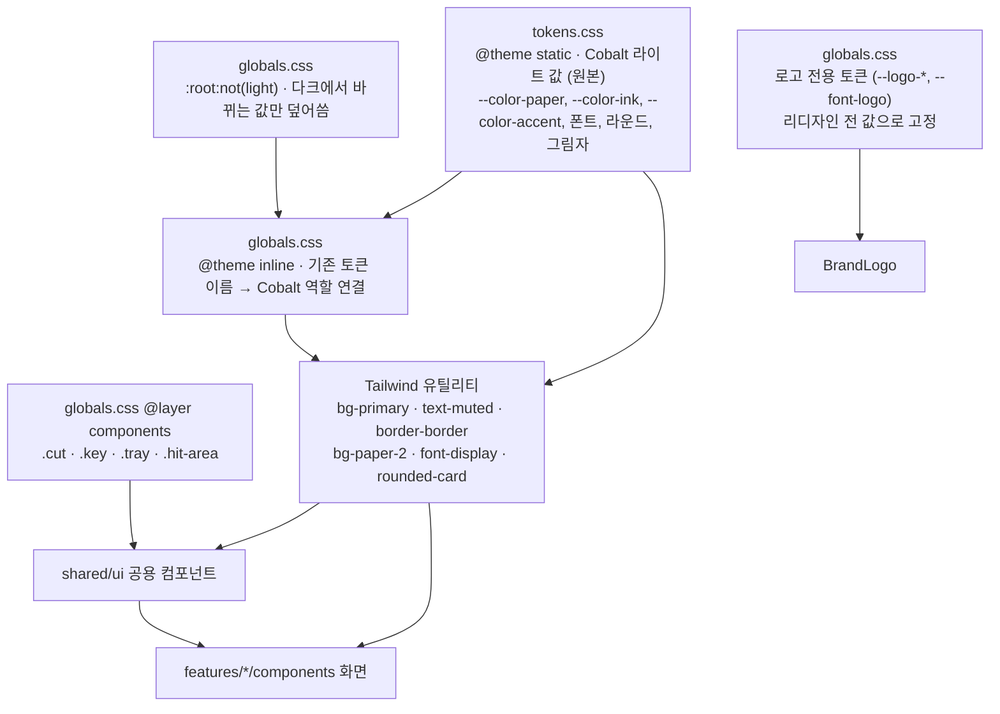

# choimory-dev-front

choimory.dev 서비스의 프론트엔드 프로젝트입니다.

현재는 여러 하위 서비스를 담는 플랫폼형 화면 구조를 기준으로 `/`, `/services`, `/notice`, `/blog`, `/feed`, `/login`, `/signup`, `/me`와 주요 메뉴/상세 화면을 구성한 상태입니다.

---

## 용어

| 용어 | 의미 |
|---|---|
| 서비스 | `choimory.dev` 플랫폼이 제공하는 개별 기능 단위. 플랫폼, blog, feed는 현재 제공 중인 서비스이며 memo, account-book, schedule은 준비 중인 서비스이다 |
| 도메인 | 하나의 서비스 안에서 하단 메뉴로 구분되는 화면 묶음. 플랫폼의 도메인은 공지사항, 커뮤니티(예정)이며 blog의 도메인은 인기, 팔로잉, feed의 도메인은 인기, 관찰이다 |

---

## 기술 스택

| 구분 | 내용 |
|---|---|
| 프레임워크 | Next.js 16.3.5 (App Router, Turbopack) |
| 언어 | TypeScript 5 (`strict: true`) |
| UI | React 19.3.0 |
| 스타일 | Tailwind CSS v4 (PostCSS 방식) |
| 폰트 | IBM Plex Sans KR(본문·한글), Familjen Grotesk(제목·숫자의 라틴 문자), JetBrains Mono(코드·기계값), Geist Mono(로고 전용) |
| 디자인 시스템 | Cobalt 테마 기반 자체 시스템 (`design.md`, 아래 [디자인 시스템](#디자인-시스템) 참고) |
| 린트 | ESLint 9 + eslint-config-next (Flat Config) |
| 테스트 | Vitest 5 + React Testing Library + jest-dom + user-event (jsdom 환경) |
| 패키지 매니저 | npm |

- Next.js 16부터 Turbopack이 기본 번들러이므로 `--turbopack` 플래그는 사용하지 않습니다.
- `next lint`는 Next.js 16에서 제거되었으므로 ESLint CLI를 직접 사용합니다.
- Vitest 5가 `@types/node` `^22` 이상을 요구하므로 `@types/node`는 `^22`를 사용합니다.

---

## 실행 방법

```bash
npm install      # 의존성 설치
npm run dev      # 개발 서버 실행 (APP_ENV=local, env/.env.local 사용, http://localhost:3000)
npm run dev:dev  # 개발 서버 실행 (APP_ENV=dev, env/.env.dev 사용)
npm run build    # 프로덕션 빌드 (APP_ENV 없음, 환경변수를 직접 주입해야 함)
npm run build:dev  # dev 환경 빌드 (env/.env.dev 사용)
npm run build:prod # prod 환경 빌드 (env/.env.prod 사용)
npm run start    # 빌드 결과 실행
npm run lint    # eslint . 실행
npm run test    # Vitest 감시 모드
npm run test:run # Vitest 1회 실행
```

타입 검사는 `npx tsc --noEmit`으로 수행합니다.

### 환경 변수

Next.js의 `NODE_ENV`는 `development`, `production`, `test`만 허용하므로, local/dev/prod 구분은 `APP_ENV`로 합니다.

```text
env/
├── .env.local   # APP_ENV=local, 내 PC 개발용 (git 제외)
├── .env.dev     # APP_ENV=dev, 개발 서버용 (git 제외)
└── .env.prod    # APP_ENV=prod, 운영 서버용 (git 제외)
.env.example     # 키 목록 템플릿 (커밋)
```

| 변수 | 사용처 | 설명 |
|---|---|---|
| `MEMBER_API_BASE_URL` | 서버(Route Handler) 전용 | Next 서버가 member-api를 호출할 때 사용하는 주소 |
| `NEXT_PUBLIC_MEMBER_API_BASE_URL` | 브라우저 | 브라우저가 member-api를 직접 호출할 때 사용하는 공개 주소 |

- `next.config.ts`가 `APP_ENV`에 맞는 `env/.env.{APP_ENV}`를 `process.loadEnvFile`로 로드합니다. `APP_ENV`는 `local`, `dev`, `prod`만 허용하며, 없으면 파일을 읽지 않고 주입된 환경변수만 사용합니다.
- 이미 주입된 환경변수는 덮어쓰지 않으므로 배포 환경에서 직접 주입한 값이 파일보다 우선합니다.
- **루트에 `.env.local`을 만들지 않습니다.** Next.js가 `next.config.ts`보다 먼저 루트 `.env*`를 로드하고 `env/`의 값은 덮어쓰지 않으므로, 같은 키가 있으면 루트 값이 이깁니다.
- `env/.env.*`는 git에 올리지 않고 `.env.example`만 커밋합니다. JWT secret은 member-api만 가지며 프론트에는 두지 않습니다.

> Next.js 16은 동일 프로젝트에서 개발 서버가 중복 실행되는 것을 차단합니다. 이미 실행 중인 서버가 있으면 해당 서버를 사용하거나 종료 후 다시 실행합니다.

---

## 프로젝트 구조

```text
src/
├── app/
│   ├── api/auth/login/route.ts       # 로그인 BFF
│   ├── api/auth/logout/route.ts      # 로그아웃 BFF
│   ├── api/auth/reissue/route.ts     # 토큰 재발급 BFF
│   ├── blog/page.tsx
│   ├── blog/following/page.tsx
│   ├── blog/me/page.tsx
│   ├── blog/popular/page.tsx
│   ├── blog/posts/[postId]/page.tsx
│   ├── blog/[nickname]/page.tsx
│   ├── blog/users/[nickname]/page.tsx
│   ├── feed/page.tsx
│   ├── feed/activities/[activityId]/page.tsx
│   ├── feed/me/page.tsx
│   ├── feed/me/targets/[targetId]/page.tsx
│   ├── feed/observations/page.tsx
│   ├── feed/observations/[observationId]/page.tsx
│   ├── feed/popular/page.tsx
│   ├── feed/targets/[targetId]/page.tsx
│   ├── base.css                      # 기본 요소 규칙 (포커스 링, 제목 서체, 모션 줄이기 등)
│   ├── favicon.ico
│   ├── globals.css                   # 다크 모드 값, 기존 토큰 이름 연결, 로고 토큰, 공용 재료 클래스
│   ├── layout.tsx                    # 폰트 로드 (next/font, <html>에 변수 클래스)
│   ├── login/page.tsx
│   ├── me/page.tsx
│   ├── notice/page.tsx
│   ├── page.tsx
│   ├── services/page.tsx
│   ├── signup/page.tsx
│   └── tokens.css                    # 디자인 토큰 원본 (Tailwind v4 @theme, 라이트 기준)
│
├── features/
│   ├── auth/
│   │   ├── api/                      # authApi (login, logout, restoreSession, join)
│   │   ├── components/
│   │   ├── container/
│   │   ├── hooks/                    # useLogin, useSignup
│   │   ├── model/
│   │   └── server/                   # authBff (BFF 핸들러, 서버 전용)
│   ├── blog/
│   │   ├── components/
│   │   ├── container/
│   │   └── model/
│   ├── feed/
│   │   ├── components/
│   │   ├── container/
│   │   └── model/
│   ├── me/
│   │   ├── components/
│   │   ├── container/
│   │   └── model/
│   └── platform/
│       ├── components/
│       ├── container/
│       └── model/
│
└── shared/
    ├── api/                          # apiClient, httpClient, tokenStore, tokenRefresher, apiTypes, bffResponse
    ├── auth/                         # refreshCookie (서버 전용)
    ├── config/                       # env (서버 전용 환경변수)
    ├── model/
    └── ui/

env/                   # APP_ENV별 환경변수 (git 제외)

design.md              # 고정된 디자인 시스템 문서 (화면 작업 시 기준)

tests/
├── fixtures/          # 테스트용 데이터 (feature별 픽스처)
└── unit/              # Vitest 단위, 컴포넌트 테스트 (src/와 같은 경로로 미러링)
    ├── features/
    │   ├── auth/ blog/ feed/ me/ platform/   # components/, container/, model/ (auth는 api/, hooks/, server/ 포함)
    └── shared/
        ├── api/ auth/ config/
        ├── model/
        └── ui/

vitest.config.mts      # Vitest 설정
vitest.setup.ts        # 테스트 공통 설정 (jest-dom 매처 등록, 렌더링 정리)
```

경로 별칭은 `@/*` → `./src/*` 입니다.

---

## 현재 화면 상태

현재 라우트는 다음과 같습니다.

| 경로 | 설명 |
|---|---|
| `/` | 여러 하위 서비스로 진입하는 플랫폼 홈 |
| `/services` | 플랫폼 전체 서비스 메뉴 |
| `/notice` | 플랫폼 공지사항 |
| `/blog` | 인스타그램 같은 글, 이미지, 댓글, 팔로우 중심의 blog 서비스 피드 |
| `/blog/popular` | blog 인기 글 메뉴 |
| `/blog/following` | blog 팔로잉 피드 메뉴 |
| `/blog/posts/[postId]` | blog 게시글 상세 |
| `/blog/[nickname]` | nickname 기반 공개 유저 blog 메인 |
| `/blog/me` | 내 blog 설정/관리 |
| `/blog/users/[nickname]` | `/blog/[nickname]`로 이동하는 호환 라우트 |
| `/feed` | 아이템, 스트리머, 아티스트 관찰 알림을 모아보는 feed 서비스 |
| `/feed/popular` | feed 인기 관찰 대상 랭킹 |
| `/feed/observations` | feed 관찰 대상 목록 |
| `/feed/observations/[observationId]` | feed 구버전 관찰 상세 |
| `/feed/activities/[activityId]` | feed 알림 상세 |
| `/feed/targets/[targetId]` | feed 관찰 대상 공통 상세 |
| `/feed/me` | 내 feed 관리 홈 |
| `/feed/me/targets/[targetId]` | 내 feed 관찰 대상 설정 상세 |
| `/login` | 로그인 화면 |
| `/signup` | 회원가입 화면 |
| `/me` | 개인정보와 사이트 설정을 관리하는 마이페이지 |

현재 구현된 주요 화면 요소는 다음과 같습니다.

- 플랫폼 홈
  - `choimory.dev` 브랜드 로고 (상단바와 홈 중앙)
  - 상단바의 로고 + 서비스 경로(`/ feed` 등)로 현재 위치 표시
  - 통합 검색바
  - 좌우 화살표로 넘기는 서비스 런처
  - 전체 서비스 메뉴
  - 상세 모달을 제공하는 공지사항 메뉴
  - 제목과 설명을 보여주는 공용 페이지 소개 영역(공지사항, 서비스, blog 인기/팔로잉, feed 인기/관찰 등)
  - 비회원 사용자용 서비스 소개 섹션
  - 로그인 사용자용 내정보 프로필 패널
  - 로그인 사용자용 서비스별 패널(숫자 줄과 알림 행), 준비 중 서비스는 한 패널 안의 행으로 묶음
  - 플랫폼형 하단 네비게이션
- blog
  - 피드 필터
  - 글 작성 진입 영역
  - 게시글 카드 (이미지 데이터가 없으면 이미지 아이콘 자리 표시)
  - 인기, 팔로잉, 내 blog 설정/관리, 공개 유저 blog 메인 화면
  - 인기 화면 상단 검색어, 멘션, 팔로워, 태그 탭형 5개 실시간 랭킹 (순위 변동은 상태색 글자로 표시)
  - 팔로잉 화면 상단 팔로워/팔로잉 탭, 검색 버튼, 화살표 paging, 관계 액션 버튼
  - 내 blog 설정/관리 화면과 유저 blog 메인 화면이 공용으로 쓰는 프로필 카드(아바타, 닉네임, 소개, 작성 글/팔로워/팔로잉 카운팅)
  - 팔로워, 팔로잉 카운트 클릭 모달과 modal paging
  - 게시글 액션, 내 글 수정 버튼, 태그 링크, 댓글 아바타, 댓글 작성, 대댓글 입력 예시를 포함한 게시글 상세 화면
  - 서비스 내부 하단 네비게이션
- feed
  - 아이템 가격 알림 소개
  - 스트리머 방송/이벤트 알림 소개
  - 아티스트 신곡/앨범/참여곡 알림 소개
  - 로그인 사용자용 관찰 대상 요약 숫자 줄
  - 아이템, 스트리머, 아티스트가 섞인 관찰 대상 목록 (행 오른쪽에 현재값을 큰 숫자로, 목표·변동은 그 아래)
  - 전체, 아이템, 스트리머, 아티스트 탭과 순차 등장 애니메이션을 포함한 인기 관찰 대상 랭킹 화면
  - 가격 요약, 그래프, 원본 링크, 방송 기록, 채팅 기록, 앨범 carousel을 섹션별로 나눈 관찰 대상 공통 상세 화면 (좁은 화면에서는 요약 숫자를 라벨·값 목록으로 표시)
  - 가격 그래프 hover/click tooltip, 방송 기록 클릭 popover와 빈 영역 닫기/긴 내용 내부 스크롤, 중앙 정렬 앨범/트랙 상세 modal
  - 프로필 카드와 관찰대상 등록 modal, 저장 버튼이 있는 내 feed 관리 홈과 대상별 알림 설정 상세
  - 기존 관찰 상세와 알림 상세 호환 화면
  - 알림 상세 화면
  - 서비스 내부 하단 네비게이션
- 인증
  - 로그인 화면 (member-api 연동, 실패 시 오류 메시지, 소셜 로그인 버튼은 화면 구성 확인용)
  - 회원가입 화면 (member-api 연동, 필드별 검증 오류 표시)
  - 상단바와 마이페이지의 로그인 상태 표시는 아직 `?auth=member` 쿼리(`shared/model/mockAuth.ts`)를 사용한다. 회원 조회 API가 생기면 실제 세션으로 교체한다
- 마이페이지
  - 프로필 요약
  - 설정 카드 클릭으로 여는 개인정보 변경 모달
  - 설정 카드 클릭으로 여는 사이트 설정 모달
  - 설정 카드 클릭으로 여는 2차 인증 모달
  - 2차 인증 사용 여부와 인증 방식 선택 UI
  - 설정 카드 클릭으로 여는 회원 탈퇴 확인 모달

---

## 디자인 시스템

화면의 색, 폰트, 표면, 컨트롤 규칙은 루트의 `design.md`에 고정되어 있습니다. 화면을 만들거나 고칠 때는 이 문서를 기준으로 하고, 시스템을 바꿀 때는 `design.md`부터 고칩니다.

### 방향

| 항목 | 내용 |
|---|---|
| 테마 | Cobalt (hallmark 테마 기반). 얇은 구분선, 키캡 버튼, 대각선 두 모서리를 깎은 패널, 코발트 강조색 하나 |
| 화면 성격 | 앱 화면. 셸(상단바 + 하단 네비게이션) 안에서 목록·숫자·폼 중심으로 구성 |
| 모드 | 다크가 기본(`:root`), 라이트는 `[data-theme="light"]`. 두 모드 토큰은 모두 준비돼 있고 전환 기능은 아직 없음 |
| 대표 요소 | 관찰 목록: 구분선 행 위의 표 형식 숫자 |

### 토큰 구조



- 컴포넌트와 테스트가 쓰는 기존 이름(`primary`, `surface`, `muted`, `accent-*` 등)은 그대로 두고 값만 Cobalt 역할로 연결합니다.

| 기존 이름 | Cobalt 역할 |
|---|---|
| `background` / `shell`·`surface` / `surface-strong` | paper / paper-2 / paper-3 |
| `foreground` / `muted` / `border` | ink / muted / rule |
| `primary` / `primary-foreground` / `primary-soft` | accent / accent-ink / accent-wash |
| `accent-green` / `accent-orange` / `accent-red` / `accent-purple` | success / warning / error / violet (상태 표시 전용) |

- 새로 만드는 화면은 Cobalt 이름(`bg-paper-2`, `text-ink-2`, `border-rule`, `font-display`, `rounded-card`, `rounded-input`)도 쓸 수 있습니다.
- 글자 크기는 Tailwind 기본 `text-xs`~`text-3xl`을 그대로 쓰고, 추가 크기로 `text-md`, `text-title`, `text-section`, `text-display-s`, `text-display`를 둡니다.

### 폰트

| 역할 | 폰트 | 유틸리티 |
|---|---|---|
| 본문, 한글 전체 | IBM Plex Sans KR | 기본(`font-sans`) |
| 제목, 숫자의 라틴 문자 | Familjen Grotesk (한글은 Plex Sans KR로 대체) | `font-display` |
| 코드, URL, 기계값 | JetBrains Mono | `font-mono` |
| 로고 | Geist Mono | `font-logo` (로고 전용) |

- 폰트 변수는 `layout.tsx`에서 `<html>`에 붙여 `:root`의 토큰에서 읽을 수 있게 합니다.
- 굵기는 400(본문), 500(라벨·보조), 600(제목·강조) 세 가지만 씁니다.
- 한글은 `word-break: keep-all`로 어절 단위 줄바꿈을 합니다.

### 공용 재료 클래스

| 클래스 | 용도 |
|---|---|
| `.cut` / `.cut-sm` | 대각선 두 모서리를 깎은 패널·태그. `corner-shape` 미지원 브라우저는 일반 라운드(8px / 6px) |
| `.key` / `.key-primary` | 아래 모서리가 있는 키캡 버튼. hover에 1px 뜨고, 누르면 가라앉고, 비활성은 흐림. primary는 코발트 |
| `.tray` | 탭·옵션 키가 놓이는 오목한 트레이 |
| `.hit-area` | 보이는 크기(32~40px)는 그대로 두고 실제 터치 영역을 최소 44px로 넓힘 |

### 화면 규칙

- 강조색(코발트)은 주요 동작, 현재 선택, 상태 표시에만 씁니다. 주요 버튼은 화면당 하나이며, 상단바 로그인/로그아웃은 보조 키입니다.
- 목록은 카드 여러 개 대신 `ListRow` 구분선 행으로 만들고, 패널 안에 테두리 있는 패널을 넣지 않습니다.
- 알약 모양(`rounded-full`), 제목 위 경로형 라벨, 가운데 점(·)으로 이어 붙인 메타 문구, 그라디언트 장식은 쓰지 않습니다.
- 상태는 배경 칩이 아니라 상태색 글자로 표시합니다.
- 색과 폰트는 토큰 유틸리티로만 지정합니다. 직접 색 값은 네이버(`#03c75a`)·카카오(`#fee500`) 로그인 버튼만 예외입니다.
- 모든 인터랙티브 요소는 hover, `:focus-visible`, active, disabled 상태를 가집니다. 모션은 상태 변화에만 쓰고 `prefers-reduced-motion`에 대응합니다.

### 로고

- `shared/ui/BrandLogo.tsx`와 타이핑 애니메이션은 디자인 시스템과 분리되어 있습니다.
- 색과 폰트는 `globals.css`의 로고 전용 토큰(`--logo-ink`, `--logo-brace`, `--logo-dot`, `--logo-paren`, `--font-logo`)에 다크·라이트 각각 고정 값으로 들어 있어, 시스템 색을 바꿔도 로고는 바뀌지 않습니다.

### 알려진 예외와 남은 일

- 네이버 로그인 버튼의 흰 글자 대비(2.25:1)는 네이버 브랜드 색 유지를 위한 예외입니다.
- 테마 전환 기능, `Modal` 키보드 포커스 처리(포커스 이동·가두기, Esc 닫기), 홈 서비스 런처의 넘침 감지 화살표, 내 피드 설정의 하위 스위치 비활성 표시는 아직 없습니다.

---

## 향후 화면 설계 방향

프론트 구성 기획은 `.agents/histories/2026/09/17/front-structure-planning/plan4.md`를 기준으로 이어갑니다.

현재 구현 방향은 다음과 같습니다.

- `choimory.dev`는 여러 하위 서비스를 담는 플랫폼으로 본다.
- 첫 화면은 특정 서비스의 피드가 아니라 서비스 포털/런처 역할을 한다.
- blog 기능은 플랫폼 자체가 아니라 하위 서비스 중 하나로 분리한다.
- feed 기능은 아이템 가격, 스트리머 활동, 아티스트 신곡 알림을 관찰 대상별로 관리하는 핵심 하위 서비스로 둔다.
- memo, account-book, schedule은 미래 계획 서비스로 두고 현재는 준비 중 상태로 표시한다.
- 플랫폼 홈, blog, 마이페이지 같은 서비스 화면은 `768px` 기준의 태블릿형 중앙 폭을 기본으로 사용한다.
- 로그인, 회원가입처럼 폼 중심의 특수 화면은 별도 좁은 중앙 폼 레이아웃을 사용할 수 있다.
- 로그인/비로그인 사용자에 따라 플랫폼 홈과 blog 화면을 분기할 수 있는 구조로 확장한다.

---

## 아키텍처 기준

화면을 다시 만들 때는 `.agents/rules/front-end/code-convention-react.md`를 따른다.

기본 계층은 다음과 같습니다.

| 계층 | 위치 | 책임 |
|---|---|---|
| `page` | `app/**/page.tsx` | 라우팅 진입점. Container 호출만 수행하며 얇게 유지한다 |
| `container` | `features/*/container` | API 호출, 상태 관리, 이벤트 흐름 |
| `hook` | `features/*/hooks` | 복잡한 상태와 이벤트 로직. UI를 반환하지 않는다 |
| `component` | `features/*/components` | UI 렌더링만 담당. props로 데이터를 전달받는다 |

공통 UI는 `shared/ui`에 둡니다.

공용 UI 컴포넌트는 다음과 같습니다. 같은 모양이 두 곳 이상 반복되면 개별 화면에서 클래스를 다시 쓰지 않고 이 컴포넌트를 사용합니다.

| 컴포넌트 | 용도 | 주요 props |
|---|---|---|
| `Card` | 1px 구분선 패널(대각선 두 모서리를 깎음). `strong`은 패널 안쪽용 테두리 없는 면 | `as`(div, section, article), `tone`(default, strong), `padding`(sm, md) |
| `Chip` | 짧은 분류를 보여주는 모서리 깎은 작은 태그 (알약 모양 아님) | `size`(sm, md), `tone`(muted, surface) |
| `IconBadge` | 아이콘이나 이니셜을 담는 사각 타일 | `as`, `size`(xs~xl), `tone`(primary, soft, strong, surface) |
| `SegmentedTabs` | 오목한 트레이 안의 보기 전환 탭, 선택 탭은 눌린 코발트 키 | `items`, `activeId`, `onChange`, `ariaLabel`, `size` |
| `ListRow` | 좌측, 본문, 우측으로 이루어진 아래 구분선 목록 행 (간격 없이 쌓아 목록 구성) | `leading`, `trailing`, `href`/`onClick`(링크/버튼), `tone`, `padding`, `isDimmed` |
| `Button` | 키캡 텍스트 버튼. primary는 화면당 하나 | `variant`(primary, secondary, outline-danger), `size`(md 40px, lg 48px) |
| `IconButton` | 아이콘만 있는 정사각 버튼 (터치 영역 44px) | `ariaLabel`(필수), `size`(sm~lg), `tone`(muted, danger, ghost) |
| `Modal` | `document.body` 포털 모달 | `labelledBy`, `onClose`, `title`, `placement`, `overlay`, `size`, `padding` |

- `ListRow`는 `href`가 있으면 링크로, `onClick`이 있으면 버튼으로, 둘 다 없으면 정적 행으로 렌더링한다.
- `strong` 톤의 `ListRow`는 구분선과 hover 효과가 없는 한 단계 진한 면이다.
- `Modal`은 배경을 누르면 `onClose`를 호출하고 패널 안쪽 클릭은 막는다. `title`을 주면 제목과 닫기 버튼 헤더를 렌더링한다.
- `feed`의 대상 종류별 라벨, 아이콘, 색상 클래스는 `features/feed/model/feedTargetView.ts`의 함수를 사용한다.

공통 화면 레이아웃은 다음 기준을 따릅니다.

- 서비스 화면의 중앙 콘텐츠는 `shared/ui/AppContent.tsx`를 사용한다.
- `AppContent`의 기본 variant는 `wide`이며, 기본 폭은 `max-w-[768px]`이다.
- `AppTopBar`와 `BottomNavigation`의 기본 폭도 wide 기준이다.
- 상단바 액션은 `shared/ui/TopBarActions.tsx`에서 검색, 알림, 서비스 popover, 로그인/로그아웃 UI를 담당한다.
- 검색 오버레이는 `document.body` portal 기반으로 렌더링하여 화면 전체 기준으로 표시한다.
- 알림과 서비스 팝오버도 `document.body` portal 기반으로 렌더링하여 화면 빈 영역 클릭으로 닫히게 한다.
- 브랜드 로고는 `shared/ui/BrandLogo.tsx`를 사용하며 화면별로 애니메이션 여부를 조정한다.
- 화면 최상단 소개 영역은 `shared/ui/PageIntroCard.tsx`를 공용으로 사용한다. 제목과 설명을 보여주며, 둘 다 없으면 아무것도 렌더링하지 않는다.
- 페이지 내부 섹션 제목은 `shared/ui/SectionHeader.tsx`를 공용으로 사용하며, 우측 액션 링크가 필요하면 `action` prop을 쓴다.
- 제목 위 경로형 라벨(eyebrow)은 쓰지 않는다. 현재 위치는 상단바의 로고와 서비스 경로가 보여준다. `PageIntroCard`, `SectionHeader`의 `domainPath` prop은 호환을 위해 받지만 화면에는 표시하지 않는다.
- heading은 간결한 명사형으로 쓴다. description은 `PageIntroCard`(화면 최상단)에서만 쓰고 따뜻한 안내형 문구로 작성하며, `SectionHeader`에는 description을 쓰지 않는다.
- 숫자와 라벨을 보여주는 통계는 `shared/ui/StatCard.tsx`를 공용으로 사용한다. `lg`는 위쪽 구분선 위의 큰 표 형식 숫자, `sm`은 진한 면이며, 클릭 가능 여부는 `onClick` prop으로 정한다.
- 좁은 레이아웃은 로그인/회원가입 같은 예외 화면에만 제한적으로 사용한다.
- 개발 확인용 공통 모델은 `shared/model`에 둔다.

---

## API 연동과 인증

member-api(`choimory-dev-member-api`)와 연동하는 구조입니다. OpenAPI 문서는 member-api의 `docs/api/v1`에 있습니다.

### 연동 중인 API

| 기능 | member-api | 호출 경로 |
|---|---|---|
| 로그인 | `POST /v1/login` | 브라우저 → `POST /api/auth/login`(BFF) → member-api |
| 토큰 재발급 | `POST /v1/member/reissue` | 브라우저 → `POST /api/auth/reissue`(BFF) → member-api |
| 로그아웃 | `POST /v1/logout` | 브라우저 → `POST /api/auth/logout`(BFF) → member-api |
| 회원가입 | `POST /v1/member/join` | 브라우저 → member-api 직접 호출 (CORS 필요) |

- member-api 공통 응답은 `{code, name, message, data}`이며, `httpRequest`가 `data`를 꺼내고 실패는 `ApiError`로 던집니다. 가입 검증 실패(400)의 `data`는 `getValidateResults`로 필드 목록을 꺼냅니다.
- 그 외 일반 API는 브라우저가 `apiClient`로 member-api를 직접 호출합니다. 일반 화면의 데이터는 클라이언트에서 불러오는 것이 기본이며, 서버 컴포넌트는 로그인 없이 볼 수 있는 공개 데이터에만 사용합니다.

### 토큰 관리

| 토큰 | 수명 | 보관 위치 |
|---|---|---|
| Refresh Token | 14일 | httpOnly 쿠키(`refresh_token`). BFF만 읽고 쓴다. SameSite=Lax, `path=/api/auth`, `secure`는 `NODE_ENV=production`일 때 |
| Access Token | 30분 | 브라우저 메모리(`shared/api/tokenStore.ts`). 새로고침하면 사라진다 |

- 로그인 응답에서 Refresh Token은 쿠키로만 전달하고, Access Token만 본문으로 내려줍니다.
- Refresh Token은 1회용(rotation)이므로 재발급할 때마다 쿠키를 새 값으로 교체합니다.
- BFF는 Refresh Token을 다루는 로그인, 로그아웃, 재발급에만 사용합니다.
- 새로고침 후 로그인 상태는 `authApi.restoreSession()`(재발급)으로 복원합니다.

### apiClient의 토큰 갱신

`createApiClient`로 만든 `apiClient`(`shared/api/apiClient.ts`)는 다음 순서로 Access Token을 처리합니다.

1. 호출 전에 만료 30초 이내이면 먼저 갱신한다. 갱신에 실패해도 요청은 보내 서버가 판단하게 한다.
2. 응답이 401 `TOKEN_EXPIRED`이면 갱신 후 원 요청을 1회만 재시도한다.
3. 갱신까지 실패하면 `onAuthExpired`(기본: `/login` 이동)를 실행하고 원래 오류를 던진다.
4. 갱신 요청은 동시에 하나만 보낸다. Refresh Token이 1회용이라 같은 토큰으로 두 번 보내면 하나가 실패하기 때문이다.
5. 인증이 필요 없는 요청은 `{ auth: false }`로 보낸다.

### 새 API를 추가할 때

- 도메인별 `features/{domain}/api/{domain}Api.ts`에 호출 함수를 작성하고 `shared/api/apiClient`를 사용한다.
- 요청/응답 타입은 `features/{domain}/model`에 분리하고, 화면용 형태가 다르면 ViewModel과 mapper를 둔다.
- Refresh Token처럼 브라우저에 노출하면 안 되는 값을 다루는 호출만 `app/api` Route Handler(BFF)로 만든다. 핸들러 로직은 `features/{domain}/server`에 두고 `route.ts`는 호출만 한다.
- member-api 오류는 `ApiError`의 `status`, `errorName`(예: `TOKEN_EXPIRED`, `DUPLICATE_EMAIL`)으로 분기한다.

---

## 코드 규칙

전체 규칙은 `.agents/rules/` 하위 문서를 따릅니다. 프론트엔드는 아래 두 문서가 기준입니다.

- `.agents/rules/front-end/code-convention-react.md`
- `.agents/rules/front-end/comment.md`

주요 사항은 다음과 같습니다.

**구조**

- `page.tsx`에서 API 호출, 복잡한 상태 관리, 이벤트 로직을 작성하지 않는다.
- UI 컴포넌트는 API를 직접 호출하지 않고 전역 상태에 직접 의존하지 않는다.
- 하나의 파일에는 하나의 주요 컴포넌트만 작성한다.
- 상태가 없는 화면에는 hook을 생성하지 않는다.

**네이밍**

- 컴포넌트 파일명은 PascalCase, hook 파일명은 `use` 접두사를 사용한다.
- 이벤트 함수는 `handle` 접두사, 이벤트 props는 `on` 접두사를 사용한다.
- boolean props는 `is`, `has`, `can`, `should` 접두사를 사용한다.

**타입**

- `any` 사용을 금지한다. 불가피하면 `unknown` 사용 후 타입 가드를 작성한다.
- API 요청 타입과 응답 타입을 분리한다.
- 화면에서 사용하는 형태가 응답과 다르면 ViewModel 타입을 별도로 작성한다.

**주석**

- 모든 컴포넌트, 타입, 함수, Custom Hook에 Doc Comment를 작성한다.
- 타입의 각 필드에는 측면 주석을 작성한다.
- 로직은 흐름 단위로 분리하여 한글 주석을 작성한다.
- 코드 자체로 의미가 명확한 부분에는 주석을 작성하지 않는다.

**문구**

- 화면에 표시하는 문구는 `~합니다/~입니다` 같은 격식체 대신 `~해요/~예요` 해요체를 사용한다.
- 안내/설명 문구(description 등)는 권유형(`~해요/~해보세요`)으로 쓴다.
- 시스템 알림, 이벤트 로그 문구(알림 제목, `recentAlerts` 등)는 완료형(`~했어요/~됐어요`)으로 쓴다.
- 댓글처럼 사용자가 작성한 대화체 텍스트는 이 규칙 적용 대상에서 제외한다.

**테스트**

- 테스트 코드는 `tests/unit/` 아래에 `src/`와 같은 경로로 두고, 파일명은 `{대상파일명}.test.ts(x)`로 한다. (예: `src/shared/ui/Card.tsx` → `tests/unit/shared/ui/Card.test.tsx`)
- 테스트에서는 `@/shared/ui/Card`처럼 경로 별칭으로 import한다.
- 여러 테스트가 같이 쓰는 테스트용 데이터는 `tests/fixtures/`에 둔다. 컨테이너 테스트만 실제 임시 데이터를 쓰고, 컴포넌트 테스트는 픽스처를 쓴다.
- `globals`를 켜지 않으므로 `describe`, `it`, `expect`, `vi`는 `vitest`에서 import한다.
- 컴포넌트 테스트는 `getByRole`, `getByLabelText` 같은 접근성 기준 쿼리를 우선 사용하고, 사용자 이벤트는 `@testing-library/user-event`로 시뮬레이션한다.
- 열거형 값(크기, 톤, variant 등)은 `it.each`로 한 번에 검증한다.
- jsdom에 없는 API(`scrollBy`, `URL.createObjectURL`)는 해당 테스트 파일에서만 `vi.fn()`으로 대체한다.
- 라우터 없이 `next/link`를 클릭하면 jsdom이 페이지 이동을 시도하므로, 링크 클릭이 필요한 테스트는 파일 안에서 `vi.mock('next/link', ...)`로 대체한다.
- 서버 전용 코드(Route Handler 핸들러 등)의 테스트는 파일 첫 줄에 `// @vitest-environment node`를 둔다. `next/headers` 같은 서버 모듈은 `vi.mock`으로 대체한다.
- API 호출 테스트는 `vi.stubGlobal('fetch', ...)` 또는 함수의 `fetchImpl` 옵션으로 fetch를 대체한다. 공통 응답 Response 생성은 `tests/fixtures/api.ts`의 `jsonResponse`를 사용한다.
- 현재 Playwright(E2E)와 MSW(API 모킹 통합 테스트)는 도입하지 않았다. API 연동 후 추가한다.

---

## 작업 히스토리

작업 내역은 `.agents/histories/`에 기록합니다. 일자별 작업 목록은 `.agents/histories/calendar.md`를 참고합니다.
